 

  

👋 Hello, I'm Kaio, but you can call me Comkas 🌱 Currently building a projection mapping app and Minecraft plugins  Projects: 🎞️ <a href="https://github.com/KAIKOAUGUSTIN/Anamorph" target="_blank" rel="noreferrer external">Anamorph</a> - Projection mapping for one canvas and any number of projectors: corner pin, mesh warp, masks and soft-edge blending (Windows, macOS and Linux) 🚁 <a href="https://github.com/KAIKOAUGUSTIN/tello" target="_blank" rel="noreferrer external">Tello Pilot</a> - Client for the DJI/Ryze Tello drone with the protocols written from scratch: live video, HUD and touch, keyboard and Xbox controls (Windows, macOS, Linux, Android and iOS) 🏹 <a href="https://github.com/KAIKOAUGUSTIN/ManhuntStar" target="_blank" rel="noreferrer external">ManhuntStar</a> - ManHunt hunter bots that play like real players, for Paper, Fabric and NeoForge 📶 <a href="https://github.com/KAIKOAUGUSTIN/cloudflare-ddns" target="_blank" rel="noreferrer external">Cloudflare DDNS Updater</a> - Keeps Cloudflare DNS records in sync with your public IP, running as a systemd service 🩵 <a href="https://github.com/KAIKOAUGUSTIN/heartbeat" target="_blank" rel="noreferrer external">Heartbeat.py</a> - A simple script to check my server status 

 

  

###

 

<picture>
  <source media="(prefers-color-scheme: dark)" srcset="https://raw.githubusercontent.com/KAIKOAUGUSTIN/KAIKOAUGUSTIN/output/pacman-contribution-graph-dark.svg">
  <source media="(prefers-color-scheme: light)" srcset="https://raw.githubusercontent.com/KAIKOAUGUSTIN/KAIKOAUGUSTIN/output/pacman-contribution-graph.svg">
  
</picture>

 

  

