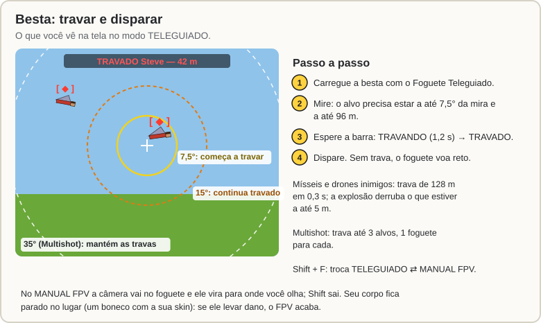

[Início](README.md) › Besta e Foguete Teleguiado

# Besta e Foguete Teleguiado

Uma **besta comum** carregada com o **[Foguete Teleguiado](Receitas.md#foguete-teleguiado)** dispara um foguete com física de verdade: empuxo, combustível que acaba, ar e gravidade. A besta tem dois modos:

| Modo | Como funciona |
|---|---|
| **TELEGUIADO** (padrão) | Você mira, espera travar e dispara. O foguete persegue o alvo sozinho. |
| **MANUAL FPV** | Ao disparar, a sua câmera vai junto com o foguete e ele vira para onde você olha. |

**Para trocar o modo:** com a besta na mão, aperte **Shift + F** (trocar de mão agachado). O modo fica salvo na própria besta.

O combustível é a **duração de voo** do foguete (1, 2 ou 3 pólvoras na receita): mais pólvora, mais tempo de motor ligado.

## Modo TELEGUIADO

1. Carregue a besta com o Foguete Teleguiado.
2. Mire no alvo. Ele precisa estar a até **96 m** e a até **7,5°** do centro da mira para começar a travar.
3. A barra no topo da tela mostra **TRAVANDO** e depois **TRAVADO** (cerca de 1,2 s). Um marcador **[ ◆ ]** aparece em cima do alvo, visível só para você.
4. Dispare. Enquanto o alvo estiver a até 15° da mira a trava continua. Se ele sair por meio segundo, a trava cai.

Sem trava, o foguete voa reto, só com a física. Quem está sendo travado vê na tela **"⚠ VOCÊ ESTÁ SENDO TRAVADO"**.

A besta trava em jogadores e mobs, e também em:

- **Mísseis em voo** (SAM, balístico, antissatélite, foguete de satélite) e **drones inimigos**, inclusive o kamikaze. Contra eles a trava alcança **128 m** e fica pronta em **0,3 s**. O foguete explode quando passa a até **5 m** e derruba os mísseis e drones inimigos nesse raio. Mesmo sem trava ou no FPV, ele detona se passar perto de um míssil.
- Ela não trava nos seus próprios mísseis, a não ser que estejam indo atrás de você, e não trava nos drones seus ou dos seus aliados.

### Multishot: até 3 alvos

Com o encantamento **Multishot**, a besta trava até **3 alvos**: mire em um, espere travar e mire no próximo. Os alvos já travados continuam travados enquanto estiverem num cone de **35°** à sua frente. Um tiro solta 3 foguetes, um para cada alvo; com menos travas, os alvos se repetem.

## Modo MANUAL FPV

- Ao disparar, a câmera acompanha o foguete e **ele vira para onde você olha**.
- Uma barra mostra o combustível, a velocidade, a altura e a distância de você.
- **Shift** sai do FPV. Por padrão o foguete continua voando sem guiagem (o admin pode trocar para ele se autodestruir).
- Quando o foguete explode, você volta para onde estava.
- O seu corpo fica parado no lugar, como um boneco com a sua skin. **Se o corpo levar dano, o FPV acaba.**
- Se um [Bloqueador de Radar](Guerra-Eletronica-e-CIWS.md#bloqueador-de-radar) inimigo cobrir o foguete, você perde o sinal e o foguete segue sem guiagem.

## Contra a besta: flare

Um [Flare](Guerra-Eletronica-e-CIWS.md#flare-e-chaff) solto pelo alvo engana o foguete. Cada flare que aparece no campo de visão do foguete tem **60%** de chance de virar o alvo dele. Quando o flare apaga, o foguete segue sem guiagem. Soltar um flare também faz quem está te travando recomeçar a trava, e uma trava já pronta cai com 50% de chance.

## Detalhes

- O Foguete Teleguiado não funciona como impulso de elytra nem como fogos de artifício comuns.
- A explosão do foguete não fere quem atirou.

---

← [O menu `/sam`](Menu.md) · Próximo: [Radar e mísseis SAM](Radar-e-Misseis-SAM.md) →
