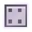
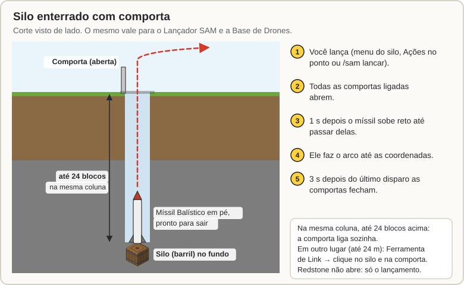
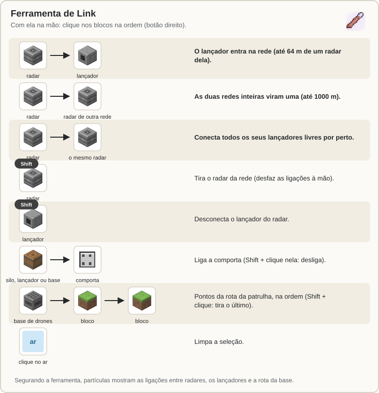

[Início](README.md) › Comportas e Ferramenta de Link

# Comportas e Ferramenta de Link

## Comportas

A **Comporta de Silo** é um alçapão de ferro que abre sozinho antes de cada disparo e fecha depois. Serve para esconder um **Lançador SAM**, um **Silo** ou uma **Base de Drones** debaixo da terra ou dentro de uma cápsula.

**Ligando a comporta:**

- **Sozinha:** coloque a comporta **na mesma coluna**, até **24 blocos acima** do lançador, silo ou base. Ela se liga sozinha (mensagem verde no chat).
- **Em outro lugar** (até 24 m): use a [Ferramenta de Link](#ferramenta-de-link). Clique no lançador, silo ou base e depois na comporta. **Shift + clique** na comporta desliga.
- Um lançador, silo ou base pode ter **várias comportas**.

**Como ela funciona:**

1. Na hora de disparar (ou de um drone sair ou pousar), **todas as comportas ligadas abrem**.
2. O míssil espera 1 s e sai subindo reto até passar delas.
3. **3 s depois do último disparo** elas fecham.

Redstone e cliques **não** abrem a comporta: só o lançamento. No menu do lançador, do silo ou da base há um botão **Comportas** para abrir e fechar e testar.

> **Atenção:** os drones saem da base voando **para cima**. Deixe o céu livre em cima dela ou ponha uma comporta.

## Ferramenta de Link

A **Ferramenta de Link** (uma luneta) liga as coisas entre si. Com ela na mão, **clique com o botão direito** nos blocos, na ordem:

| Você clica em | O que acontece |
|---|---|
| radar → lançador | O lançador entra na rede do radar (ele precisa estar a até 64 m de um radar dela). |
| radar → radar de outra rede | As duas redes inteiras viram uma (até 1000 m). O segundo radar fica selecionado: dá para ir ligando um por um. |
| radar → o mesmo radar | Conecta todos os seus lançadores livres a até 64 m de qualquer radar da rede. |
| Shift + clique no radar | Tira o radar da rede (desfaz as ligações à mão dele). |
| Shift + clique no lançador | Desconecta o lançador do radar. |
| lançador, silo ou base → comporta | Liga a comporta a ele. Shift + clique na comporta: desliga. |
| base de drones → blocos | Cada bloco clicado vira um ponto da **rota da patrulha**, na ordem. Shift + clique num bloco tira o último ponto. Até 32 pontos, a até 1000 m da base. |
| clique no ar | Limpa a seleção (para começar de novo sem ligar nada). |

Enquanto você segura a ferramenta, partículas mostram:

- as ligações à mão entre radares (linhas douradas) e os radares da rede selecionada (amarelos);
- os lançadores conectados;
- a rota da base de drones selecionada (ou o círculo, se ela não tiver pontos).

Você só liga os seus próprios equipamentos (o admin liga de qualquer um).

---

← [Silo e Míssil Balístico](Silo-e-Missil-Balistico.md) · Próximo: [Satélite](Satelite.md) →
