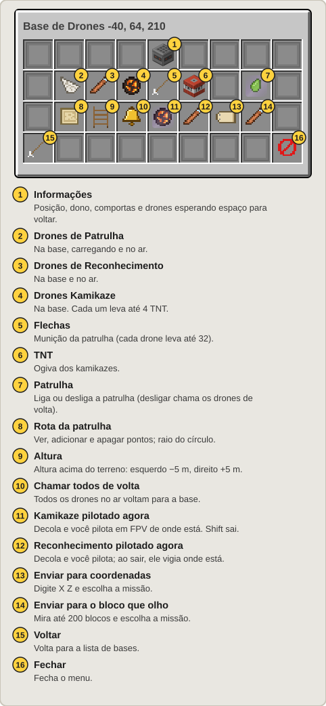
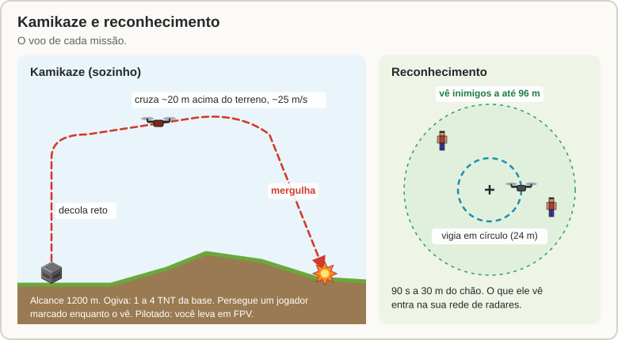

[Início](README.md) › Drones

# Drones

Uma **Base de Drones** guarda e lança três drones:

| | Drone | O que faz |
|:---:|---|---|
|  | **Patrulha** | Voa uma rota em volta da base acompanhando o relevo e atira flechas nos inimigos. |
|  | **Reconhecimento** | Vai até um ponto e vigia. O que ele vê entra na sua rede de radares. |
|  | **Kamikaze** | Leva TNT da base até um ponto, jogador ou equipamento e explode. Vai sozinho ou você pilota em FPV. |

## A Base de Drones

- É uma **bancada automática (crafter)** que não fabrica nada. Coloque e ponha dentro **drones**, **flechas** (munição da patrulha) e **TNT** (ogiva dos kamikazes). Só esses itens entram, e funis não tiram nada dela.
- Gerencie com **`/sam drones`** (olhando para a base, abre ela) ou `/sam` → **Bases de Drones**.
- Os drones saem voando **para cima**: deixe o céu livre ou ponha uma [Comporta](Comportas-e-Ferramenta-de-Link.md) em cima, que abre sozinha quando um drone sai ou pousa.

## O drone no mundo

- Um modelo de blocos com quatro hélices girando.
- Leva dano de **tudo** do jogo: flecha, espada, explosão, foguete, fogo. Vida: 20 (patrulha) e 12 (reconhecimento).
- Derrubado, ele se desfaz e **o item se perde**. O dono é avisado de quem derrubou.
- Ao pousar (ou quando o servidor desliga), ele volta como item para dentro da base. Se ela estiver cheia ou descarregada, entra quando der.
- Cada drone carrega os chunks em volta dele e à frente enquanto voa.

## Patrulha

- Com a **patrulha ligada** (padrão), todos os drones de patrulha da base saem, um a cada 3 s, e voam a rota. Não há limite de drones por base.
- **Só voam com gente por perto:** enquanto houver um jogador a até 256 m da base ou da rota. Sem ninguém, os drones são guardados.
- **Rota:**
  - **sem pontos:** um círculo de 48 m em volta da base (o raio muda no menu, em **Rota da patrulha**);
  - **com pontos:** um laço que passa por eles na ordem. Até 32 pontos, a até 1000 m da base.
- **Para marcar os pontos:**
  - com a [Ferramenta de Link](Comportas-e-Ferramenta-de-Link.md#ferramenta-de-link): clique na base e depois nos blocos, na ordem (Shift + clique tira o último);
  - no menu da base: **Rota da patrulha** → **Adicionar minha posição**;
  - pelo mapa do satélite: marque o ponto → **Drones** → a base → **Adicionar à rota da patrulha**.
- **Altura:** 20 m acima do terreno (muda por base no menu, de 5 em 5 m). O drone olha o chão embaixo e até 24 m à frente: sobe antes de chegar num morro e nunca fica a menos de 3 m do chão.
- **Ataque:** inimigos a até **32 m**, com linha de visada, pelas mesmas regras do radar (dono, aliados e time não). O drone para a uns 12 m do alvo e atira **1 flecha por segundo**, com a mira (e a imprecisão) de um esqueleto. Cada drone leva até 32 flechas da base. As flechas não podem ser pegas e não ferem você, seus aliados nem os drones de vocês.
- **Volta para a base** com pouca vida, pouca bateria (5 min de voo), sem flechas ou quando você clica em **Chamar todos de volta**. Depois de pousar, recarrega 20 s.

## Missões: kamikaze e reconhecimento

**Como mandar:**

- No menu da base: **Enviar para coordenadas** ou **Enviar para o bloco que olho** abre a tela de missão.
- Pelo mapa do satélite ([Terminal](Satelite.md#terminal-de-satélite) ou [Mesa](Mesa-de-Radar.md)): marque o ponto → **Drones** → escolha a base.
- Pilotado na hora: **Kamikaze pilotado agora** ou **Reconhecimento pilotado agora**, direto no menu da base.

### Kamikaze

- **Sozinho:** o alvo pode ser um ponto, um jogador ou um equipamento inimigo marcado no mapa do satélite, umas coordenadas ou o bloco que você olha. Ele decola reto, cruza 20 m acima do terreno a ~25 m/s e mergulha no alvo. Um jogador é perseguido enquanto o kamikaze o vê; se ele sumir, o kamikaze vai ao último lugar onde o viu. **Alcance: 1200 m.**
- **Pilotado:** decola da base e você pilota em FPV de onde estiver, como o foguete da besta (o seu corpo fica no lugar). **Shift** sai, e ele se desfaz no ar.
- **Ogiva:** a TNT da base, até **4 por kamikaze** (1 TNT = uma TNT normal). É uma explosão normal do jogo: quebra blocos com `mobGriefing` ligada.
- O alvo vê na tela **"⚠ DRONE"** com a distância.

### Reconhecimento

- Vai até o ponto (ou até o jogador marcado, e o acompanha) a **30 m do chão** e vigia em círculo por **90 s**.
- Os inimigos que ele vê a até **96 m** entram na **sua rede de radares**: aparecem na Mesa e no Terminal, e os SAMs atiram se estiverem ao alcance de um lançador.
- **Pilotado:** você leva o drone em FPV para onde olha. **Shift** sai, e ele fica vigiando onde está.

## De longe

Como os outros equipamentos, mandar um drone de longe precisa de **comunicação** (rádio a 500 m ou [satélite](Satelite.md)). Se a base estiver descarregada, ela é carregada para o lançamento.

## Contra drones

Radares derrubam drones inimigos ([antidrone](Radar-e-Misseis-SAM.md#drones-e-mísseis-inimigos-antidrone-e-antimíssil)). A [besta](Besta.md) trava neles, o [CIWS](Guerra-Eletronica-e-CIWS.md#ciws) atira neles, um [Bloqueador de Radar](Guerra-Eletronica-e-CIWS.md#bloqueador-de-radar) corta o sinal e um [EMP](EMP-e-Alertas.md#ogiva-emp) derruba todos os que estiverem na área. Qualquer arma do jogo também funciona.

---

← [Satélite](Satelite.md) · Próximo: [Guerra eletrônica e CIWS](Guerra-Eletronica-e-CIWS.md) →
