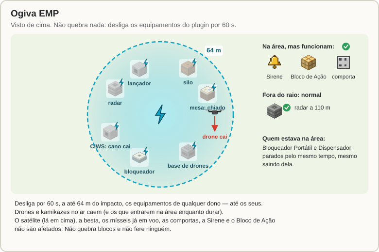
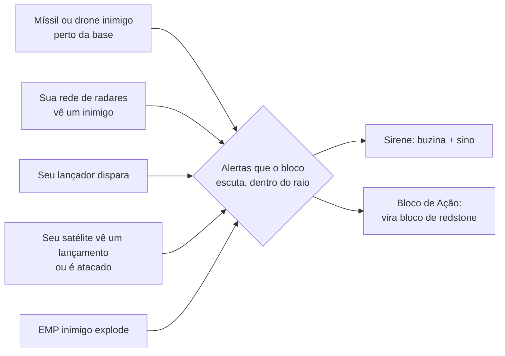
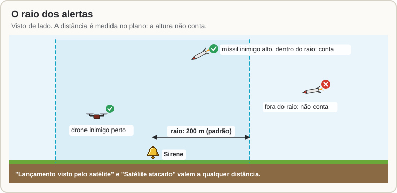
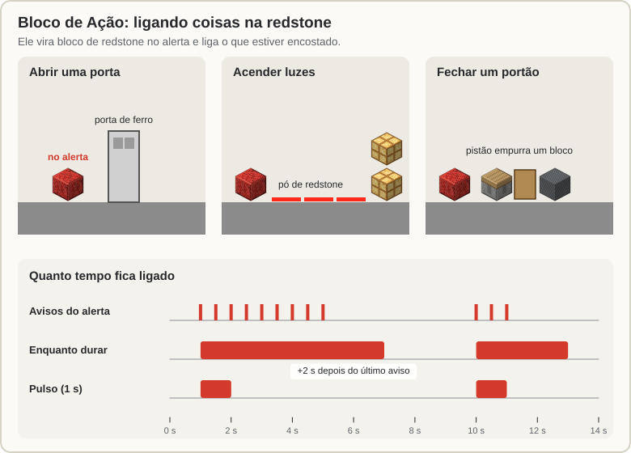
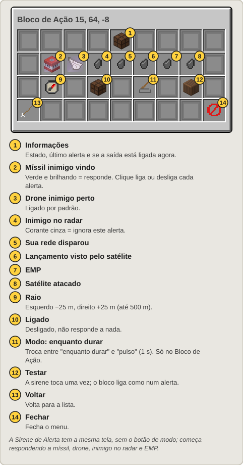

[Início](README.md) › EMP e alertas da base

# EMP e alertas da base

## Ogiva EMP

A **Carga EMP** é uma ogiva do [Míssil Balístico](Silo-e-Missil-Balistico.md) que **não quebra nada e não fere ninguém**. Em vez de explodir, ela desliga por um tempo todos os equipamentos do plugin perto do impacto.

**Como lançar:**

- Ponha **Cargas EMP** no silo (junto com os Mísseis Balísticos). No menu do silo, clique em **Ogiva** para trocar de TNT para EMP. Escolha o alvo e lance como sempre.
- Ou pelo mapa do satélite: marque o ponto → **[Ações no ponto](Satelite.md#ações-no-ponto)** → **Lançar EMP**.

O lançamento gasta um míssil e uma carga (a TNT fica guardada no silo). O míssil voa igual ao balístico normal e pode ser derrubado do mesmo jeito.

**Na chegada:**

- um clarão, faíscas e um anel de faíscas mostrando a área;
- por **60 s**, tudo do plugin a até **64 m** fica desligado, **de qualquer dono, até os seus**:
  - radares (não veem nada; a rede segue com os outros);
  - lançadores e silos (não lançam);
  - Mesas de Radar (só chiado);
  - CIWS (o cano cai);
  - Bloqueadores de Radar;
  - Bases de Drones;
- **drones e kamikazes no ar dentro da área caem**, e também os que entrarem nela enquanto o EMP durar;
- quem estava na área fica com o **Bloqueador Portátil** e o **Dispensador** parados pelo mesmo tempo, mesmo saindo dela;
- o menu e o `/sam info` mostram "desligado por EMP" e quanto tempo falta;
- quem lançou recebe quantos equipamentos e drones foram atingidos, e cada dono recebe quantos equipamentos dele foram desligados.

**Não são afetados:** o satélite (lá em cima), a besta, os mísseis que já estão voando, as comportas, a Sirene de Alerta e o Bloco de Ação.

---

## Alertas da base

Dois blocos avisam você quando algo acontece perto da base:

| | Bloco | No mundo é | O que faz no alerta |
|:---:|---|---|---|
|  | **Sirene de Alerta** | um sino | toca a **buzina de ataque** (a do saque de vila) e balança o sino |
|  | **Bloco de Ação** | uma lâmpada de redstone | vira **bloco de redstone** e liga o que estiver encostado |

Os dois são **mecânicos**: o EMP não os desliga, então eles também avisam um EMP.

### Os 7 alertas

| Alerta | Quando dispara |
|---|---|
| **Míssil inimigo vindo** | um míssil inimigo cujo ponto de impacto (balístico, EMP) ou posição (foguete, SAM, kamikaze) está dentro do raio |
| **Drone inimigo perto** | um drone ou kamikaze inimigo dentro do raio |
| **Inimigo no radar** | a sua rede de radares (ou um reconhecimento seu) vê um inimigo dentro do raio |
| **Sua rede disparou** | um lançador seu dentro do raio disparou um SAM |
| **Lançamento visto pelo satélite** | o seu satélite viu um lançamento inimigo (**qualquer distância**) |
| **EMP** | um EMP inimigo explodiu dentro do raio |
| **Satélite atacado** | o seu satélite está sendo atacado (**qualquer distância**) |

- Mísseis, drones e EMPs **seus ou de aliados** não disparam alerta.
- A distância é medida **no plano**: um míssil alto em cima da base conta.
- "Inimigo no radar" precisa que a sua rede (ou um reconhecimento) esteja vendo o inimigo. A sirene não é um detector de jogadores por conta própria.

**Quanto dura um alerta:** um alerta contínuo (míssil, drone, inimigo) fica ligado até **2 s depois do último aviso**. O de EMP dura enquanto o EMP durar, e o de lançamento visto, até o impacto previsto.

### Sirene de Alerta

- Toca a buzina (ouvida a até 200 m) e balança o sino **quando começa** um alerta, e repete a cada **8 s** enquanto ele durar.
- Começa respondendo a: míssil vindo, drone inimigo, inimigo no radar e EMP. Raio inicial: 200 m.
- Se o bloco que segura o sino sumir, a sirene cai como o item dela.

### Bloco de Ação

- Vira **bloco de redstone** (liga os 6 lados) no alerta e volta a ser lâmpada depois.
- **Modos:**
  - **enquanto durar** (padrão): ligado do começo ao fim do alerta;
  - **pulso:** liga por **1 s** quando começa cada alerta.
- Começa respondendo a: míssil vindo e drone inimigo. Raio inicial: 200 m.
- Quando o servidor desliga, os Blocos de Ação voltam a ser lâmpada.

Ideias: fechar um portão com pistões, abrir um bunker, acender as luzes da base, ligar um alarme de dispensers com fogos de artifício...

### Configurando: `/sam alertas`

`/sam alertas` (olhando para uma sirene ou um Bloco de Ação, abre ele) ou `/sam` → **Alertas da base**. Na tela de cada um:

- os 7 alertas: clique em cada um para ligar ou desligar (verde brilhando = responde; corante cinza = ignora);
- o **raio**: clique esquerdo −25 m, direito +25 m, até 500 m;
- **Ligado/desligado**;
- o **modo** (só no Bloco de Ação);
- **Testar**: a sirene toca uma vez; o bloco liga como num alerta.

De longe, mexer neles precisa de [comunicação](Satelite.md#comunicação-rádio-e-satélite). O admin pode desligar todas as sirenes e blocos de ação do servidor.

---

← [Guerra eletrônica e CIWS](Guerra-Eletronica-e-CIWS.md) · Próximo: [Comandos e permissões](Comandos-e-Permissoes.md) →
