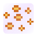
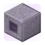
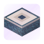
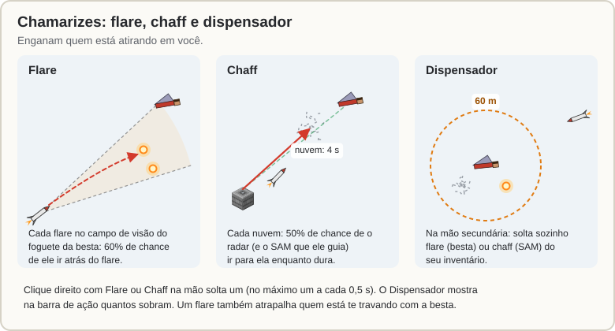
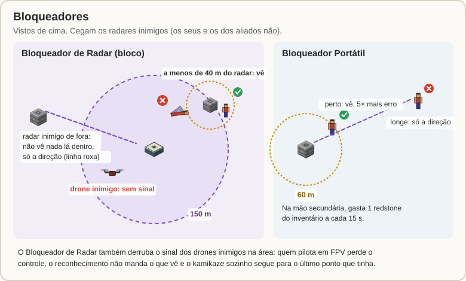
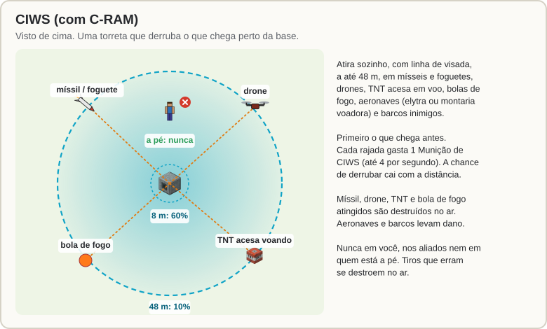

[Início](README.md) › Guerra eletrônica e CIWS

# Guerra eletrônica e CIWS

Quatro formas de se defender sem atirar e uma torreta que atira por você:

| | Item | Onde fica | Contra o quê |
|:---:|---|---|---|
|  | **Flare** | na mão (clique direito) | foguete da besta |
|  | **Chaff** | na mão (clique direito) | radar e míssil SAM |
|  | **Dispensador de Contramedidas** | mão secundária | solta flare e chaff sozinho |
|  | **Bloqueador Portátil** | mão secundária | radares inimigos te veem só de perto |
|  | **Bloqueador de Radar** | bloco | radares e drones inimigos perto da base |
|  | **CIWS** | bloco | mísseis, drones, TNT e bolas de fogo que chegam perto |

## Flare e chaff

**Clique direito** com eles na mão solta um. O máximo é um a cada 0,5 s.

- **Flare:** cai queimando por **3 s** e engana o **foguete da besta**. Cada flare que aparece no campo de visão do foguete tem **60%** de chance de virar o alvo dele. Também atrapalha quem está te travando: a trava recomeça, e uma trava já pronta cai com 50% de chance.
- **Chaff:** uma nuvem de tiras de metal que dura **4 s** e engana o **radar**. Cada nuvem tem **50%** de chance de puxar o radar para ela enquanto dura, e o **míssil SAM** guiado por ele vai junto.

## Dispensador de Contramedidas

Segure o **Dispensador** na **mão secundária**. Quando um míssil que vem em você chega a **60 m**, ele solta sozinho **flare** contra o foguete da besta e **chaff** contra o SAM, gastando os que estão no seu inventário (um a cada 0,5 s enquanto o míssil vem). A barra de ação mostra quantos sobram e avisa quando acabam.

## Bloqueadores

### Bloqueador Portátil

- Fica na **mão secundária** e gasta **1 redstone a cada 15 s** do seu inventário. Sem redstone, ele desliga e avisa.
- Os radares inimigos só te veem a menos de **60 m** deles, e com 5 vezes mais erro. Mais longe, a [Mesa de Radar](Mesa-de-Radar.md) deles mostra só uma linha na sua direção.

### Bloqueador de Radar

- É um **bloco** (emissor de sculk que não grita). Liga e desliga em **`/sam defesa`**.
- Os radares inimigos não veem **nada** (jogadores, drones, mísseis) a até **150 m** dele, a não ser o que estiver a menos de **40 m** do próprio radar. A Mesa deles mostra a direção do bloqueio.
- Os **drones inimigos** na área perdem o sinal:
  - quem pilota em FPV (kamikaze, reconhecimento ou o foguete da besta) perde o controle: o kamikaze se desfaz, o foguete segue sem guiagem e o reconhecimento fica vigiando onde estava;
  - o reconhecimento não manda para a rede o que vê;
  - o kamikaze sozinho segue para o último ponto que tinha do alvo.
- Não vale contra os seus equipamentos nem os dos seus aliados.

## CIWS

O **CIWS** (com C-RAM, numa torreta só) é um liberador (dropper) com **Munição de CIWS** dentro. Uma torreta aparece em cima dele e gira para o alvo.

- Atira **sozinho**, com linha de visada, a até **48 m**.
- **Alvos:** mísseis e foguetes (de besta, SAM, balístico, kamikaze), drones, **TNT acesa voando**, bolas de fogo, **aeronaves** (elytra ou montaria voadora) e **barcos** inimigos.
- **Nunca** atira em quem está a pé, em você, nos seus aliados ou no que é de vocês.
- Primeiro o que **chega antes** na torreta.
- Cada rajada gasta **1 munição** (até 4 por segundo) e tem uma chance de derrubar que cai com a distância: **60%** até 8 m, **10%** a 48 m.
- Míssil, drone, TNT e bola de fogo atingidos são destruídos no ar. Aeronaves e barcos levam dano a cada rajada.
- Os tiros são só o traço no ar: os que erram se destroem sozinhos, sem cair em lugar nenhum.
- Sem munição, ele avisa o dono.
- O admin pode tirar aeronaves e barcos da lista de alvos.

## `/sam defesa`

`/sam defesa` (ou `/sam` → **Defesa e guerra eletrônica**) lista os seus CIWS (munição e abates) e Bloqueadores de Radar. Clique em um para ligar ou desligar. De longe, precisa de [comunicação](Satelite.md#comunicação-rádio-e-satélite).

Um [EMP](EMP-e-Alertas.md#ogiva-emp) desliga CIWS e Bloqueadores de Radar por 60 s (o cano do CIWS cai), e para o Bloqueador Portátil e o Dispensador de quem estava na área.

---

← [Drones](Drones.md) · Próximo: [EMP e alertas da base](EMP-e-Alertas.md) →
