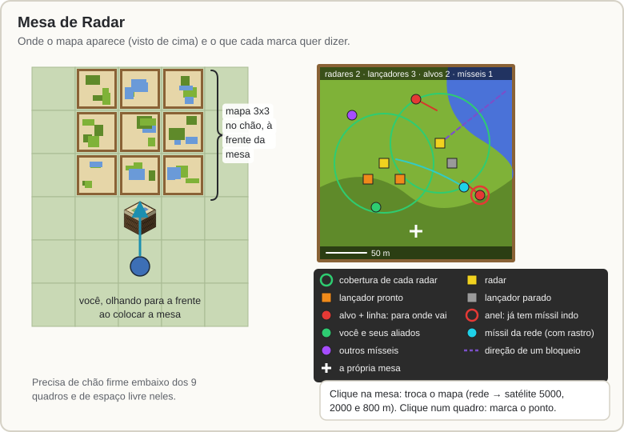

[Início](README.md) › Mesa de Radar

# Mesa de Radar

A **Mesa de Radar** é uma bancada de cartografia que desenha num **mapa 3x3 no chão** tudo o que a sua rede de radares vê: radares, lançadores, alvos, aliados e mísseis no ar. Ela também mostra o mapa do [satélite](Satelite.md) e serve para **marcar um ponto** e mandar um míssil ou drone até ele.

## Colocando

- **Olhe para onde você quer o mapa** e coloque a mesa. O mapa ocupa um quadrado de 3x3 blocos **logo à frente dela**, no mesmo nível.
- Os 9 blocos do mapa precisam estar **livres** (ar) e ter **chão firme embaixo**. Sem espaço, a mesa não é colocada e o chat avisa.
- A mesa mostra a rede do **seu radar mais perto**, a até **128 m** dela, e ajusta o zoom para caber a cobertura de todos os radares da rede. O topo do mapa aponta para a frente da mesa.

## O que o mapa mostra (modo rede)

| Marca | Significa |
|---|---|
| círculo verde | cobertura de cada radar |
| quadrado amarelo | radar |
| quadrado laranja | lançador pronto (cinza: sem munição ou recarregando) |
| ponto vermelho com uma linha | alvo detectado e para onde ele vai |
| anel vermelho em volta do alvo | já tem míssil indo nele |
| ponto verde | você e seus aliados |
| ponto ciano com rastro | míssil da sua rede |
| ponto roxo | outros mísseis |
| linha roxa tracejada saindo de um radar | direção de um **bloqueio**: o radar não vê o que está lá |
| cruz branca | a própria mesa |

No topo aparecem quantos radares, lançadores, alvos e mísseis no ar a rede tem; embaixo, a escala. **Inimigos só aparecem se algum radar da rede (ou um [drone de reconhecimento](Drones.md#reconhecimento) seu) os detectar.** O mapa atualiza 2 vezes por segundo. Atingida por um [EMP](EMP-e-Alertas.md#ogiva-emp), a mesa mostra só chiado e o tempo que falta.

## Cliques

| Clique | O que faz |
|---|---|
| **Clique direito na mesa** | Troca o mapa: rede de radares → satélite 5000 m → 2000 m → 800 m → rede... e mostra a rede no chat. |
| **Shift + clique direito na mesa** | Abre a bancada de cartografia normal do jogo. |
| **Clique direito num quadro do mapa** | Marca aquele ponto e abre as [Ações no ponto](Satelite.md#ações-no-ponto) (lançar míssil, EMP, drones, mover o satélite). No modo satélite, perto de um jogador ou equipamento inimigo, a marca gruda nele. |

Os modos de satélite só funcionam com um [satélite](Satelite.md) seu (ou de um aliado que confia em você) cobrindo a mesa. Neles o mapa é igual ao do [Terminal de Satélite](Satelite.md#terminal-de-satélite).

Quem pode usar a mesa: o dono, os aliados dele e os admins.

---

← [Radar e mísseis SAM](Radar-e-Misseis-SAM.md) · Próximo: [Silo e Míssil Balístico](Silo-e-Missil-Balistico.md) →
