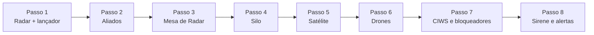

[Início](README.md) › Primeiros passos

# Primeiros passos

Este guia leva você do zero até uma base que se defende sozinha. Faça na ordem: cada passo usa o anterior. Os desenhos de cada receita estão em [Receitas](Receitas.md), e todas elas já aparecem no seu livro de receitas.

## 0. O menu

Digite **`/sam`**. Abre um baú com um botão para cada tipo de equipamento seu: radares, lançadores, silos, satélite, drones, defesa e alertas. Quase tudo nesta wiki dá para fazer por ele. Veja [O menu `/sam`](Menu.md).

Outro comando que ajuda muito: olhe para qualquer equipamento do plugin e digite **`/sam info`**. O chat mostra o estado dele.

**Antes de tudo, os componentes.** Quase todo equipamento pede um [Circuito de Guiagem](Receitas.md#circuito-de-guiagem) (ouro, quartzo e redstone), e os mísseis pedem [Combustível de Foguete](Receitas.md#combustível-de-foguete) (pólvora, pó de blaze e creme de magma). Tenha alguns de cada à mão.

## 1. Uma defesa que atira sozinha: radar e lançador

**Fabrique:** 1 [Radar Antiaéreo](Receitas.md#radar-e-mísseis-sam), 1 ou mais [Lançadores SAM](Receitas.md#radar-e-mísseis-sam) e alguns [Mísseis SAM](Receitas.md#radar-e-mísseis-sam).

1. **Coloque o Radar num lugar alto**, com o céu aberto em volta. Ele vê a até 200 m, mas morros e prédios escondem quem está atrás.
2. **Coloque o Lançador a até 64 m do radar.** Ele já sai conectado (aparece uma mensagem verde no chat).
3. **Clique com o botão direito no lançador e ponha Mísseis SAM dentro.** Funis (hoppers) também abastecem.
4. Pronto. O radar ataca sozinho **quem voa de elytra** perto da base. Esse é o modo **Aéreo**, o padrão.

Para atacar também quem anda no chão, olhe para o radar e digite `/sam modo terrestre` (só no chão) ou `/sam modo ambos`. Isso também pode ser feito pelo menu: `/sam` → Radares → o radar → **Alvos**.

> **Testando sozinho?** O radar não ataca o dono. Para ver ele funcionando, ligue **Atacar o dono** no menu do radar (ou `/sam alvo-dono on` olhando para ele), voe de elytra por perto e depois desligue.

Mais detalhes em [Radar e mísseis SAM](Radar-e-Misseis-SAM.md).

## 2. Proteja seus amigos: aliados

Digite **`/sam confiar <jogador>`**. Os seus radares, drones e CIWS deixam de atacar essa pessoa. Quem está no mesmo time do scoreboard também não é atacado.

A confiança vale num sentido só: se você confia no Steve, os seus equipamentos não atacam o Steve. Para os equipamentos dele não atacarem você, ele também precisa usar `/sam confiar` com o seu nome. `/sam aliados` mostra a sua lista e `/sam desconfiar <jogador>` tira alguém dela.

## 3. Veja tudo num mapa: Mesa de Radar

**Fabrique:** 1 [Mesa de Radar](Receitas.md#radar-e-mísseis-sam).

Coloque a mesa perto do seu radar (a até 128 m), **olhando para onde você quer o mapa**. O mapa aparece num quadrado 3x3 no chão, logo à frente da mesa. Os 9 blocos precisam estar livres e ter chão firme embaixo. Veja o desenho em [Mesa de Radar](Mesa-de-Radar.md).

## 4. Ataque de longe: o silo

**Fabrique:** 1 [Silo de Míssil](Receitas.md#silo-comporta-e-emp), [Mísseis Balísticos](Receitas.md#silo-comporta-e-emp) e junte **TNT**.

1. Coloque o silo (um barril) e ponha os mísseis e a TNT dentro. Quanto mais TNT, maior a explosão; a barra de ação mostra o tamanho esperado.
2. `/sam` → Silos → o silo → escolha o alvo: digite as coordenadas, use a sua posição ou o bloco que você está olhando.
3. Clique em **LANÇAR** e confirme.

O alcance depende do nível do míssil, e cada nível tem a sua receita: 300, 650 ou 1000 m no padrão (o servidor pode mudar). O nível 1 é barato. O nível 2 pede diamantes, e o 3 pede estrela do Nether e netherite. Veja [Silo e Míssil Balístico](Silo-e-Missil-Balistico.md).

## 5. Comande de qualquer lugar: o satélite

Sem satélite, você só mexe nos seus equipamentos a até **500 m** deles (o "rádio"). Com um satélite em órbita, você comanda tudo o que estiver na cobertura dele, que tem 5000 m de raio.

**Fabrique:** 1 [Satélite](Receitas.md#satélite) e, se quiser, o [Terminal de Satélite](Receitas.md#satélite) (o mapa na mão).

Ponha o Satélite no silo e use **Lançar satélite** no menu do silo. Veja [Satélite](Satelite.md).

## 6. Drones

**Fabrique:** 1 [Base de Drones](Receitas.md#drones) e os drones que quiser.

Coloque a base e ponha dentro os drones, **flechas** (a munição da patrulha) e **TNT** (a ogiva dos kamikazes). Com a patrulha ligada, os drones de patrulha saem sozinhos e voam em volta da base atirando nos inimigos. Deixe o céu livre em cima da base ou ponha uma comporta. Veja [Drones](Drones.md).

## 7. Defesa de perto e guerra eletrônica

- **CIWS:** uma torreta que derruba mísseis, drones e TNT que chegam a até 48 m. Ponha **Munição de CIWS** dentro.
- **Bloqueador de Radar:** os radares inimigos não veem nada perto dele.
- **Flare, chaff e dispensador:** carregue com você para enganar mísseis.

Veja [Guerra eletrônica e CIWS](Guerra-Eletronica-e-CIWS.md).

## 8. Seja avisado: sirene e Bloco de Ação

- A **Sirene de Alerta** toca uma buzina quando vem míssil, drone ou inimigo.
- O **Bloco de Ação** liga circuitos de redstone nesses alertas: fechar portões, acender luzes...

Configure em `/sam alertas`. Veja [EMP e alertas da base](EMP-e-Alertas.md).

## Erros comuns no começo

| O que acontece | Por quê |
|---|---|
| "Esse equipamento não é seu." | Só o dono (ou um admin) mexe nele. |
| O radar não atira em você | O radar nunca ataca o dono (a não ser com "Atacar o dono" ligado). Também não ataca aliados nem quem é do seu time. |
| O radar não atira em quem anda | O modo padrão é **Aéreo**. Troque para Terrestre ou Os dois. |
| "Sem comunicação" no menu | Você está a mais de 500 m do equipamento e sem satélite cobrindo os dois. |
| Não consigo usar um item do plugin numa receita | Itens do plugin só entram onde a receita pede aquele item (o Combustível de Foguete e o Circuito de Guiagem). Fora disso, não servem de ingrediente. |

Mais casos em [Perguntas frequentes](Perguntas-Frequentes.md).

---

Próximo: [Receitas](Receitas.md) →
