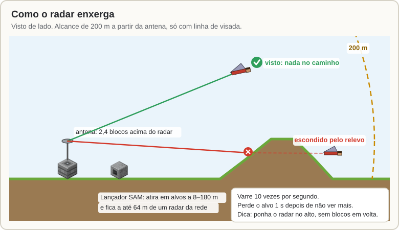
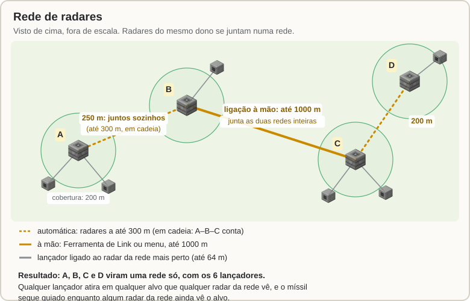
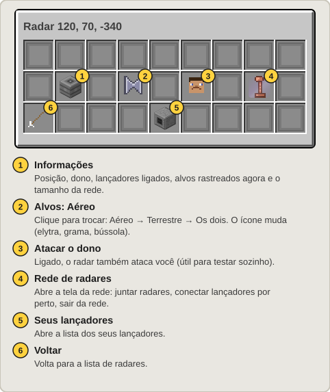
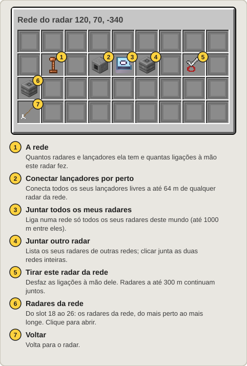
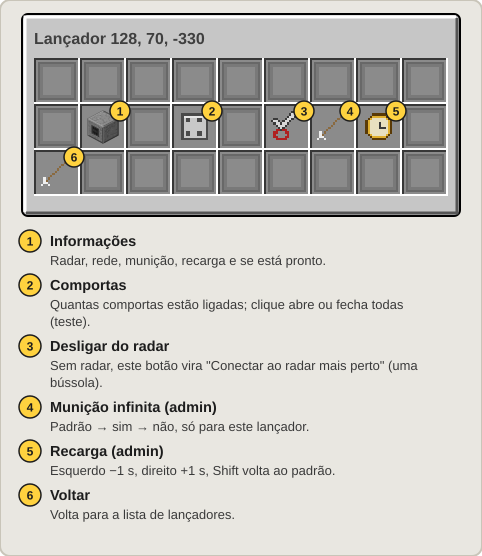

[Início](README.md) › Radar e mísseis SAM

# Radar e mísseis SAM

O **Radar Antiaéreo** vê os alvos em volta e comanda os **Lançadores SAM** conectados a ele. Os lançadores disparam **Mísseis SAM**, que o radar guia até o alvo. Tudo funciona sozinho: você monta e abastece.

## Montando

1. Coloque o **Radar** num lugar alto e aberto.
2. Coloque os **Lançadores** a até **64 m** do radar. Um lançador novo perto de um radar seu já sai conectado ao mais perto, e um radar novo conecta os seus lançadores livres por perto.
3. Ponha **Mísseis SAM** dentro dos lançadores (clique direito, ou com funis). O lançador só aceita Mísseis SAM e usa primeiro o que tem mais combustível.
4. Escolha **o que o radar ataca** (veja abaixo).

Para conectar um lançador que ficou de fora, use a [Ferramenta de Link](Comportas-e-Ferramenta-de-Link.md#ferramenta-de-link) (clique no radar e depois no lançador) ou o menu: `/sam` → Lançadores → o lançador → **Conectar ao radar mais perto**.

Confira tudo olhando para o radar e digitando `/sam info`: dono, modo, lançadores, alvos rastreados e a rede.

## O que o radar ataca: Aéreo, Terrestre ou Os dois

| Modo | Ataca |
|---|---|
| **Aéreo** (padrão) | Quem voa de **elytra** ou montado em algo que voa (a 3 blocos ou mais do chão, fora da água). |
| **Terrestre** | Todo o resto: quem está **andando, nadando, a cavalo ou de barco**. |
| **Os dois** | Os dois. |

- Troque no menu (`/sam` → Radares → o radar → **Alvos**) ou olhando para o radar com `/sam modo aereo`, `/sam modo terrestre` ou `/sam modo ambos`.
- Cada radar tem o seu modo, e ele fica salvo.
- No chão o míssil sobe na vertical e mergulha, por isso alvos no chão a menos de **20 m** do lançador não são atacados.
- O admin pode desligar só o ataque a alvos no chão no servidor inteiro. Aí os radares Terrestre e Os dois param de atacar quem está no chão.

**O radar nunca ataca:** o dono (a não ser com **Atacar o dono** ligado, para testar), os seus [aliados](Comandos-e-Permissoes.md#aliados) e quem é do mesmo time do scoreboard. Ele só vê jogadores no modo sobrevivência ou aventura.

## Como o radar enxerga

- **Alcance de 200 m** a partir da antena (2,4 blocos acima do radar), em todas as direções, inclusive para cima.
- **Precisa de linha de visada.** Blocos entre a antena e o alvo escondem o alvo, e quem voa baixo atrás de um morro não é visto.
- Varre 10 vezes por segundo, com um pequeno erro de medida. Perde o alvo 1 s depois de não vê-lo mais.
- Os lançadores atiram em alvos entre **8 m e 180 m** deles.
- Quem é detectado recebe na tela **"⚠ RADAR INIMIGO TE DETECTOU"**. Quando um míssil vem em alguém, essa pessoa vê **"⚠ MÍSSIL!"** e ouve bipes que aceleram conforme ele chega.

### Drones e mísseis inimigos (antidrone e antimíssil)

Nos modos que atacam o ar (Aéreo e Os dois), o radar também vê e ataca os **drones** inimigos (patrulha, reconhecimento e kamikaze) e os **mísseis balísticos, antissatélites e foguetes de satélite** inimigos. A espoleta do SAM detona a até **6 m** de um míssil alvo, e a explosão derruba os mísseis e drones inimigos nesse raio.

### O que atrapalha o radar

- **[Chaff](Guerra-Eletronica-e-CIWS.md#flare-e-chaff):** a nuvem pode puxar o radar (e o SAM) para ela.
- **[Bloqueadores](Guerra-Eletronica-e-CIWS.md#bloqueador-de-radar):** o portátil faz o radar só ver quem o carrega de muito perto; o de base esconde tudo a até 150 m dele.
- **[EMP](EMP-e-Alertas.md#ogiva-emp):** desliga o radar por 60 s.
- Chunk descarregado: um radar longe de todos os jogadores não varre.

## O Míssil SAM

- Sai do lançador e é guiado pelo radar até o alvo.
- Se a rede perder o alvo, o míssil se autodestrói 3 s depois.
- Cada lançador tem uma recarga entre dois disparos (4 s no padrão).
- Pode ser derrubado pelo [foguete da besta](Besta.md) ou por um [CIWS](Guerra-Eletronica-e-CIWS.md#ciws).

## Rede de radares

Radares do **mesmo dono** viram uma **rede**. A rede junta o que todos os radares veem: **qualquer lançador** dela atira em um alvo visto por **qualquer radar** dela, e o míssil continua guiado enquanto algum radar da rede vê o alvo. Um radar em cada ponta da base cobre a base inteira.

**Dois jeitos de formar a rede (eles se somam):**

1. **Sozinhos, pela distância:** radares a até **300 m** uns dos outros já estão na mesma rede. Vale em cadeia: A–B–C formam uma rede mesmo com A longe de C.
2. **À mão, até 1000 m:** ligue um radar a outro. A ligação junta as **redes inteiras**: se A–B é uma rede e C–D é outra, ligar B a C deixa os 4 radares juntos, com todos os lançadores. Se os dois radares escolhidos estiverem longe demais, a ligação é feita pelo par mais perto entre as duas redes.

**Como ligar à mão:**

| Onde | Como |
|---|---|
| [Ferramenta de Link](Comportas-e-Ferramenta-de-Link.md#ferramenta-de-link) | Clique num radar e depois num radar de **outra rede**: as duas viram uma. O radar clicado fica selecionado, então dá para ir ligando um por um. |
| | Clique **de novo no mesmo radar**: conecta todos os seus lançadores livres a até 64 m de qualquer radar da rede. |
| | **Shift + clique num radar**: tira ele da rede (desfaz as ligações à mão dele). |
| Menu | `/sam` → Radares → o radar → **Rede de radares**: conectar lançadores por perto, juntar todos os meus radares, juntar outro radar, tirar este radar da rede. |
| Comando | Olhando para um radar: `/sam rede` (abre o menu da rede), `/sam rede juntar-todos`, `/sam rede lancadores` ou `/sam rede sair`. |

**Bom saber:**

- Segurando a Ferramenta de Link, as ligações à mão aparecem como linhas douradas entre os radares, e os radares da rede selecionada ficam amarelos.
- Se um radar do meio sai da rede ou é destruído, os radares ligados a ele são ligados entre si: a rede não se parte. Os lançadores dele ficam livres. Para reconectá-los, clique duas vezes num radar da rede com a ferramenta.
- As ligações ficam salvas. A rede continua valendo com parte dos radares em chunks descarregados, mas só os carregados veem e disparam.
- **Quantos mísseis por alvo:** a regra vale para a rede toda, então dois radares vendo o mesmo alvo não disparam em dobro. Por padrão a rede espalha os mísseis, um por alvo de cada vez (o admin pode trocar para concentrar todos no alvo mais perto).

## As telas do menu

| Radar | Rede do radar |
|:---:|:---:|
|  |  |

| Lançador | |
|:---:|:---:|
|  | Mais telas em [O menu `/sam`](Menu.md). |

---

← [Besta](Besta.md) · Próximo: [Mesa de Radar](Mesa-de-Radar.md) →
