[Início](README.md) › Receitas

# Receitas

Todas as receitas são feitas numa **bancada de trabalho** comum e aparecem no seu **livro de receitas** quando você entra no servidor. Cada receita abaixo mostra a bancada como no jogo: o item que vai em cada casa e, à direita, o item que sai (com a quantidade). Embaixo vêm o que o item faz e a lista dos itens.

> **Estas são as receitas padrão.** O servidor pode mudar qualquer uma (veja [Administração](Administracao.md#receitas-receitasyml)). Se uma receita daqui não funcionar, confira no livro de receitas do jogo: ele mostra as que valem no seu servidor.

**O custo acompanha o poder do item.** O que é caro entra onde faz sentido:

- **Estrela do Nether** é uma fonte de energia forte. Vai no Satélite e no último estágio do Míssil Balístico nível 3.
- **Netherite** não queima e aguenta tudo. Vai na blindagem do Satélite (radiação em órbita), no tubo do Silo (o fogo do motor) e no escudo do Balístico nível 3.
- **Diamante** é blindagem dura. Vai no Satélite e no escudo do Balístico nível 2.
- Os consumíveis de defesa (Míssil SAM, flare, chaff, munição de CIWS) continuam baratos.

**Como ler as receitas:**

- **Sem forma:** quando a lista de itens diz isso, os itens podem ir em qualquer casa da grade.
- **Os itens que brilham são do plugin**: o [Combustível de Foguete](#combustível-de-foguete) (um frasco de mel brilhando) e o [Circuito de Guiagem](#circuito-de-guiagem) (um comparador brilhando). Faça eles antes. O comparador que não brilha é o comparador comum do jogo. Um item do plugin só entra na casa que pede aquele item: um Míssil SAM, por exemplo, não serve de ingrediente, e um fragmento de eco comum não substitui o combustível.
- **Duração de voo = combustível.** O Foguete Teleguiado, o Míssil SAM e o Míssil Balístico têm "duração de voo" 1, 2 ou 3, como os fogos de artifício. No Foguete Teleguiado ela vem da quantidade de pólvora na receita. O Míssil SAM sai com duração 3. O Míssil Balístico tem uma receita para cada nível: o nível é a duração e define o alcance.
- O admin também entrega qualquer item com `/sam dar` (veja [Comandos](Comandos-e-Permissoes.md)).
- Ícones e textura da bancada: Minecraft (Mojang), via [minecraft.wiki](https://minecraft.wiki/w/Category:Item_icons).

## Todos os itens

| | Item | No mundo é | Para que serve | Rende |
|:---:|---|---|---|:---:|
|  | [Combustível de Foguete](#combustível-de-foguete) | item | componente dos mísseis e do drone kamikaze | 1 |
| 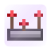 | [Circuito de Guiagem](#circuito-de-guiagem) | item | componente de quase todo equipamento | 1 |
|  | [Foguete Teleguiado](#foguete-teleguiado) | munição de besta | foguete que trava no alvo ou que você pilota | 3 |
| 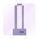 | [Míssil SAM](#míssil-sam) | item | munição do Lançador SAM | 2 |
|  | [Radar Antiaéreo](#radar-antiaéreo) | magnetita (lodestone) | vê alvos e comanda os lançadores | 1 |
| 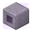 | [Lançador SAM](#lançador-sam) | ejetor virado para cima | dispara os Mísseis SAM | 1 |
|  | [Mesa de Radar](#mesa-de-radar) | bancada de cartografia | mapa 3x3 da rede no chão | 1 |
|  | [Ferramenta de Link](#ferramenta-de-link) | luneta | liga radares, lançadores, comportas e rotas | 1 |
|  | [Míssil Balístico](#míssil-balístico) (níveis 1, 2 e 3) | item | munição do Silo (vai até coordenadas) | 1 |
|  | [Silo de Míssil](#silo-de-míssil) | barril virado para cima | lança balísticos, satélite e antissatélite | 1 |
|  | [Comporta de Silo](#comporta-de-silo) | alçapão de ferro | abre sozinha antes de cada disparo | 1 |
| 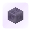 | [Carga EMP](#carga-emp) | item | ogiva EMP do balístico | 1 |
| 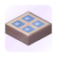 | [Satélite](#satélite-1) | item (vai no silo) | comunicação de longe, mapa e alertas | 1 |
| 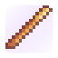 | [Míssil Antissatélite](#míssil-antissatélite) | item (vai no silo) | derruba satélites inimigos | 1 |
| 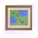 | [Terminal de Satélite](#terminal-de-satélite) | mapa | o mapa do satélite na mão | 1 |
|  | [Base de Drones](#base-de-drones) | bancada automática (crafter) | guarda e lança os drones | 1 |
|  | [Drone de Patrulha](#drone-de-patrulha) | item (vai na base) | voa uma rota e atira flechas | 1 |
|  | [Drone de Reconhecimento](#drone-de-reconhecimento) | item (vai na base) | vigia um ponto para o seu radar | 1 |
| 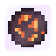 | [Drone Kamikaze](#drone-kamikaze) | item (vai na base) | voa até o alvo e explode | 1 |
|  | [Flare](#flare) | item | engana o foguete da besta | 8 |
|  | [Chaff](#chaff) | item | engana o radar e o SAM | 8 |
|  | [Dispensador de Contramedidas](#dispensador-de-contramedidas) | item (mão secundária) | solta flare e chaff sozinho | 1 |
|  | [Bloqueador Portátil](#bloqueador-portátil) | item (mão secundária) | radares inimigos só te veem de perto | 1 |
|  | [Bloqueador de Radar](#bloqueador-de-radar) | emissor de sculk | cega radares inimigos em 150 m | 1 |
|  | [CIWS](#ciws) | liberador (dropper) | torreta que derruba o que chega perto | 1 |
| 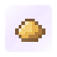 | [Munição de CIWS](#munição-de-ciws) | item | munição do CIWS | 32 |
|  | [Sirene de Alerta](#sirene-de-alerta) | sino | toca a buzina nos alertas | 1 |
| 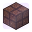 | [Bloco de Ação](#bloco-de-ação) | lâmpada de redstone | vira bloco de redstone nos alertas | 1 |

Quebrar um bloco do plugin devolve o item dele (e o que estava dentro). No modo criativo nada cai.

---

## Componentes

Os dois componentes não fazem nada sozinhos: eles entram nas receitas dos outros itens. No jogo e nas imagens, eles brilham.

### Combustível de Foguete

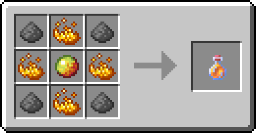

Componente: vai nos mísseis (SAM, Balístico e Antissatélite) e no Drone Kamikaze.

**Itens:** 4× Pólvora · 4× Pó de Blaze · 1× Creme de Magma

### Circuito de Guiagem

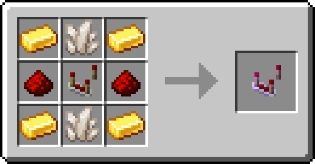

Componente: a eletrônica de quase todo equipamento do plugin (mísseis, satélite, radar, lançador, CIWS, bloqueadores, drones, mesa e terminal).

**Itens:** 4× Lingote de Ouro · 2× Quartzo do Nether · 2× Pó de Redstone · 1× Comparador de Redstone

---

## Besta

### Foguete Teleguiado

Munição da besta: carregue como um foguete de fogos comum. A quantidade de pólvora é a duração de voo (1, 2 ou 3). Cada receita rende 3.

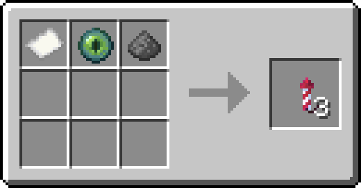

**Duração de voo 1.** Itens (sem forma: vão em qualquer casa da grade): 1× Papel · 1× Olho de Ender · 1× Pólvora

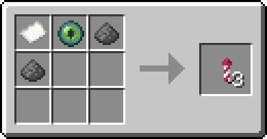

**Duração de voo 2.** Itens (sem forma: vão em qualquer casa da grade): 1× Papel · 1× Olho de Ender · 2× Pólvora

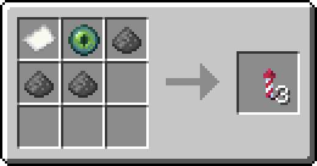

**Duração de voo 3.** Itens (sem forma: vão em qualquer casa da grade): 1× Papel · 1× Olho de Ender · 3× Pólvora

Como usar: [Besta](Besta.md).

---

## Radar e mísseis SAM

### Míssil SAM

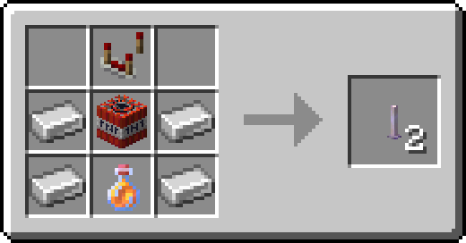

Munição do Lançador SAM. Sai com duração de voo 3, e cada receita rende 2.

**Itens:** 1× Comparador de Redstone · 4× Lingote de Ferro · 1× TNT · 1× [Combustível de Foguete](#combustível-de-foguete)

### Radar Antiaéreo

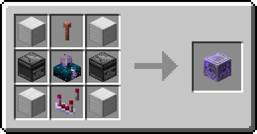

Bloco (magnetita) que vê os alvos e comanda os Mísseis SAM dos lançadores da rede.

**Itens:** 4× Bloco de Ferro · 1× Para-Raios · 2× Observador · 1× Sensor de Sculk Calibrado · 1× [Circuito de Guiagem](#circuito-de-guiagem)

### Lançador SAM

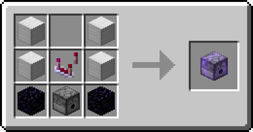

Bloco (ejetor virado para cima) que dispara os Mísseis SAM quando o radar manda. Colocado perto de um radar seu, já sai conectado.

**Itens:** 4× Bloco de Ferro · 1× [Circuito de Guiagem](#circuito-de-guiagem) · 2× Obsidiana · 1× Ejetor

### Mesa de Radar

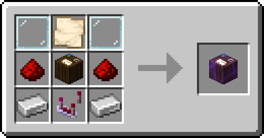

Bloco (bancada de cartografia) que desenha num mapa 3x3 no chão, à frente dela, tudo o que a sua rede de radares vê.

**Itens:** 2× Vidraça · 1× Mapa em Branco · 2× Pó de Redstone · 1× Bancada de Cartografia · 2× Lingote de Ferro · 1× [Circuito de Guiagem](#circuito-de-guiagem)

### Ferramenta de Link

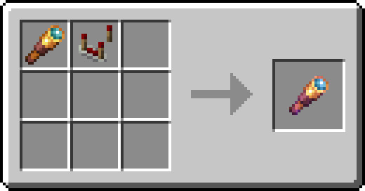

Luneta que liga o radar aos lançadores, junta redes, liga comportas e desenha a rota da patrulha dos drones.

**Itens (sem forma: vão em qualquer casa da grade):** 1× Luneta · 1× Comparador de Redstone

Como usar: [Radar e mísseis SAM](Radar-e-Misseis-SAM.md), [Mesa de Radar](Mesa-de-Radar.md) e [Comportas e Ferramenta de Link](Comportas-e-Ferramenta-de-Link.md).

---

## Silo, comporta e EMP

### Míssil Balístico

O Míssil Balístico tem uma receita para cada nível. O nível é a duração de voo e define até onde ele vai:

| Nível | Alcance padrão | O que tem de caro |
|:---:|---|---|
| 1 | 40 a 300 m | nada: 2 combustíveis, bússola, circuito e ferro |
| 2 | 40 a 650 m | 2 diamantes (escudo de reentrada) e 3 combustíveis |
| 3 | 40 a 1000 m | 1 estrela do Nether e 2 lingotes de netherita, com 4 combustíveis |

O alcance de cada nível é do servidor: num mapa grande, o admin pode deixar, por exemplo, 10, 20 e 30 mil blocos.

#### Míssil Balístico nível 1

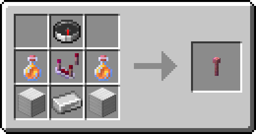

Munição do Silo: voa até as coordenadas escolhidas no silo e explode com a TNT guardada nele (o míssil não leva TNT). Nível 1 (duração de voo 1): alcance padrão de até 300 m; o servidor pode mudar em `balistico.alcance-max-por-nivel`.

**Itens:** 1× Bússola · 2× [Combustível de Foguete](#combustível-de-foguete) · 1× [Circuito de Guiagem](#circuito-de-guiagem) · 2× Bloco de Ferro · 1× Lingote de Ferro

#### Míssil Balístico nível 2

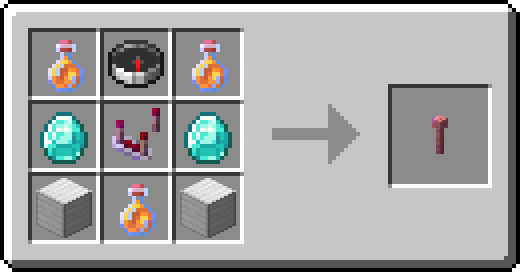

Munição do Silo: voa até as coordenadas escolhidas no silo e explode com a TNT guardada nele (o míssil não leva TNT). Nível 2 (duração de voo 2): alcance padrão de até 650 m; o servidor pode mudar em `balistico.alcance-max-por-nivel`.

**Itens:** 3× [Combustível de Foguete](#combustível-de-foguete) · 1× Bússola · 2× Diamante · 1× [Circuito de Guiagem](#circuito-de-guiagem) · 2× Bloco de Ferro

#### Míssil Balístico nível 3

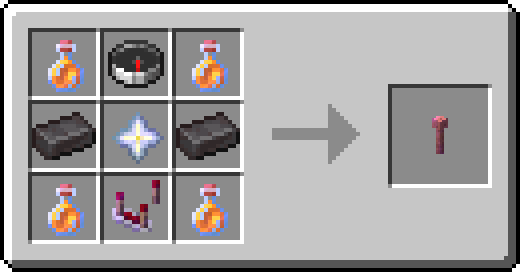

Munição do Silo: voa até as coordenadas escolhidas no silo e explode com a TNT guardada nele (o míssil não leva TNT). Nível 3 (duração de voo 3): alcance padrão de até 1000 m; o servidor pode mudar em `balistico.alcance-max-por-nivel`.

**Itens:** 4× [Combustível de Foguete](#combustível-de-foguete) · 1× Bússola · 2× Lingote de Netherita · 1× Estrela do Nether · 1× [Circuito de Guiagem](#circuito-de-guiagem)

### Silo de Míssil

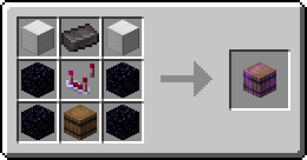

Bloco (um barril) que lança os Mísseis Balísticos, o Satélite e o Míssil Antissatélite. Guarde dentro os mísseis e a TNT da ogiva; mais TNT, explosão maior.

**Itens:** 2× Bloco de Ferro · 1× Lingote de Netherita · 4× Obsidiana · 1× [Circuito de Guiagem](#circuito-de-guiagem) · 1× Barril

### Comporta de Silo

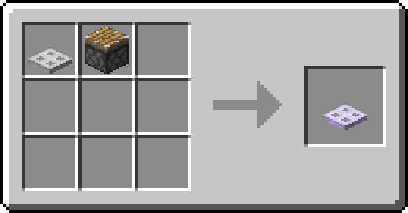

Alçapão de ferro que abre sozinho antes do disparo do silo, do lançador ou da base de drones, e fecha depois.

**Itens (sem forma: vão em qualquer casa da grade):** 1× Alçapão de Ferro · 1× Pistão

### Carga EMP

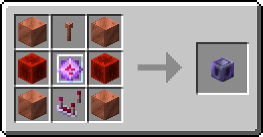

Ogiva EMP do Míssil Balístico (vai no silo): não quebra nada, mas desliga radares, lançadores, CIWS, bloqueadores e bases perto do impacto, e derruba drones.

**Itens:** 4× Bloco de Cobre · 1× Para-Raios · 2× Bloco de Redstone · 1× Cristal do End · 1× [Circuito de Guiagem](#circuito-de-guiagem)

Como usar: [Silo e Míssil Balístico](Silo-e-Missil-Balistico.md), [Comportas e Ferramenta de Link](Comportas-e-Ferramenta-de-Link.md) e [EMP e alertas da base](EMP-e-Alertas.md).

---

## Satélite

### Satélite

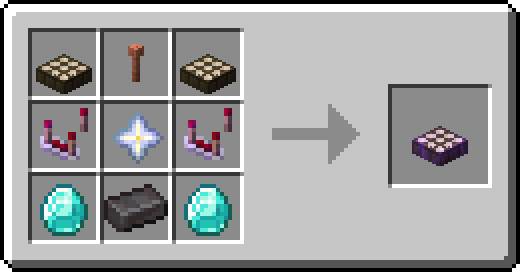

Vai no Silo e sobe pelo menu do silo ("Lançar satélite"). Em órbita, dá comunicação com a base de longe, mapa da área e alerta de lançamentos. Um por jogador, e pode ser derrubado.

**Itens:** 2× Detector de Luz Solar · 1× Para-Raios · 2× [Circuito de Guiagem](#circuito-de-guiagem) · 1× Estrela do Nether · 2× Diamante · 1× Lingote de Netherita

### Míssil Antissatélite

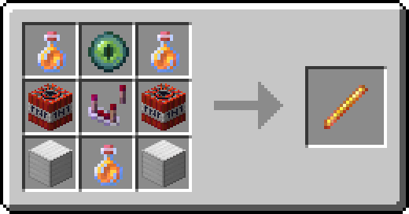

Munição do Silo contra satélites inimigos (menu do silo → "Antissatélite").

**Itens:** 3× [Combustível de Foguete](#combustível-de-foguete) · 1× Olho de Ender · 2× TNT · 1× [Circuito de Guiagem](#circuito-de-guiagem) · 2× Bloco de Ferro

### Terminal de Satélite

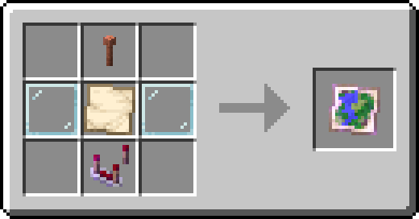

Um mapa: na mão, mostra o que o seu satélite vê. Clique direito mira e marca um ponto; Shift + clique direito muda o zoom.

**Itens:** 1× Para-Raios · 2× Vidraça · 1× Mapa em Branco · 1× [Circuito de Guiagem](#circuito-de-guiagem)

Como usar: [Satélite](Satelite.md).

---

## Drones

### Base de Drones

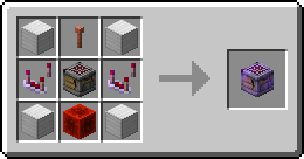

Bloco (bancada automática) que guarda e lança os drones. Ponha dentro os drones, flechas para a patrulha e TNT para os kamikazes. Gerencie em `/sam drones`.

**Itens:** 4× Bloco de Ferro · 1× Para-Raios · 2× [Circuito de Guiagem](#circuito-de-guiagem) · 1× Bancada Automática · 1× Bloco de Redstone

Os três drones têm a mesma receita: muda só o item de baixo, no meio. É a carga do drone: a arma (ejetor), a câmera (luneta) ou o motor do kamikaze (Combustível de Foguete).

### Drone de Patrulha

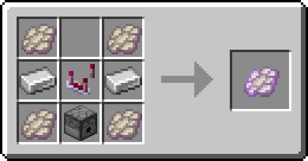

Vai na Base de Drones. Com flechas na base, voa a rota da patrulha e atira nos inimigos.

**Itens:** 4× Membrana de Espectro · 2× Lingote de Ferro · 1× [Circuito de Guiagem](#circuito-de-guiagem) · 1× Ejetor

### Drone de Reconhecimento

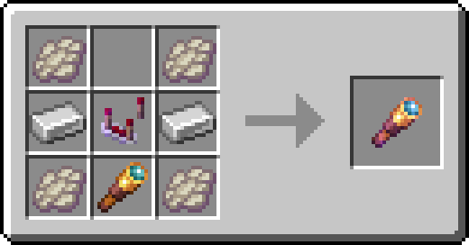

Vai na Base de Drones. Voa até um ponto e vigia: o que ele vê entra na sua rede de radares.

**Itens:** 4× Membrana de Espectro · 2× Lingote de Ferro · 1× [Circuito de Guiagem](#circuito-de-guiagem) · 1× Luneta

### Drone Kamikaze

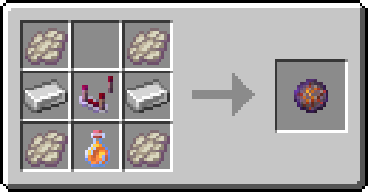

Vai na Base de Drones. Leva a TNT da base até o alvo e explode; vai sozinho ou você pilota em FPV.

**Itens:** 4× Membrana de Espectro · 2× Lingote de Ferro · 1× [Circuito de Guiagem](#circuito-de-guiagem) · 1× [Combustível de Foguete](#combustível-de-foguete)

Como usar: [Drones](Drones.md).

---

## Guerra eletrônica e CIWS

### Flare

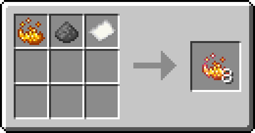

Clique direito: solta um flare que engana o foguete da besta. Rende 8.

**Itens (sem forma: vão em qualquer casa da grade):** 1× Pó de Blaze · 1× Pólvora · 1× Papel

### Chaff

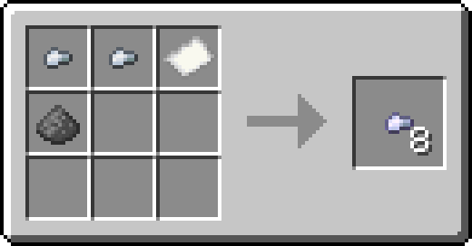

Clique direito: solta uma nuvem de chaff que engana o radar e o Míssil SAM. Rende 8.

**Itens (sem forma: vão em qualquer casa da grade):** 2× Pepita de Ferro · 1× Papel · 1× Pólvora

### Dispensador de Contramedidas

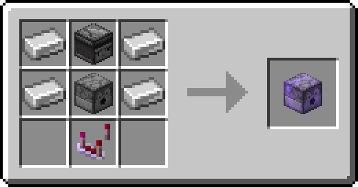

Na mão secundária: solta flare e chaff sozinho quando um míssil vem em você, gastando os do inventário.

**Itens:** 4× Lingote de Ferro · 1× Observador · 1× Ejetor · 1× [Circuito de Guiagem](#circuito-de-guiagem)

### Bloqueador Portátil

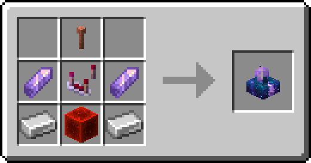

Na mão secundária: radares inimigos só te veem de perto. Gasta redstone do inventário.

**Itens:** 1× Para-Raios · 2× Fragmento de Ametista · 1× [Circuito de Guiagem](#circuito-de-guiagem) · 2× Lingote de Ferro · 1× Bloco de Redstone

### Bloqueador de Radar

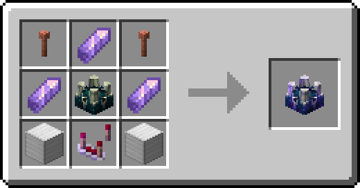

Bloco: radares inimigos não veem nada perto dele, e drones inimigos perdem o sinal. Liga e desliga em `/sam defesa`.

**Itens:** 2× Para-Raios · 3× Fragmento de Ametista · 1× Emissor de Sculk · 2× Bloco de Ferro · 1× [Circuito de Guiagem](#circuito-de-guiagem)

### CIWS

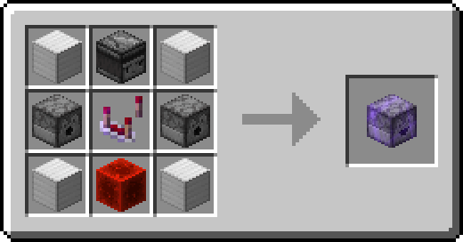

Torreta (liberador) com Munição de CIWS dentro: derruba mísseis, drones, TNT e bolas de fogo que chegam perto. Nunca atira em quem está a pé.

**Itens:** 4× Bloco de Ferro · 1× Observador · 2× Ejetor · 1× [Circuito de Guiagem](#circuito-de-guiagem) · 1× Bloco de Redstone

### Munição de CIWS

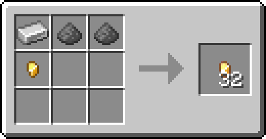

Munição do CIWS: gasta 1 por rajada. Rende 32.

**Itens (sem forma: vão em qualquer casa da grade):** 1× Lingote de Ferro · 2× Pólvora · 1× Pepita de Ouro

Como usar: [Guerra eletrônica e CIWS](Guerra-Eletronica-e-CIWS.md).

---

## Alertas da base

### Sirene de Alerta

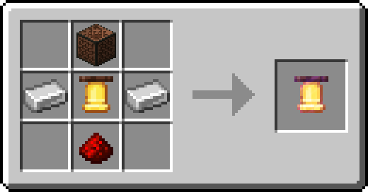

Bloco (sino) que toca a buzina de ataque nos alertas escolhidos em `/sam alertas`.

**Itens:** 1× Bloco Musical · 2× Lingote de Ferro · 1× Sino · 1× Pó de Redstone

### Bloco de Ação

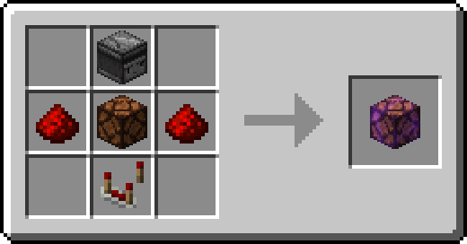

Bloco (lâmpada de redstone) que vira bloco de redstone nos alertas escolhidos em `/sam alertas`.

**Itens:** 1× Observador · 2× Pó de Redstone · 1× Lâmpada de Redstone · 1× Comparador de Redstone

Como usar: [EMP e alertas da base](EMP-e-Alertas.md).

---

← [Primeiros passos](Primeiros-Passos.md) · Próximo: [O menu `/sam`](Menu.md) →
