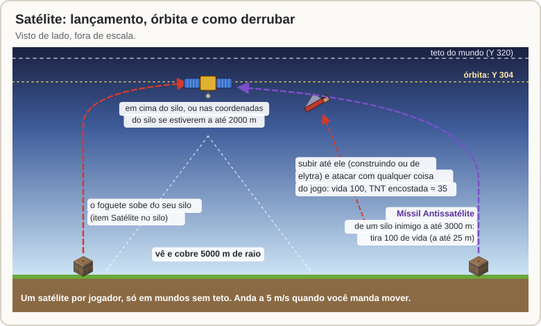
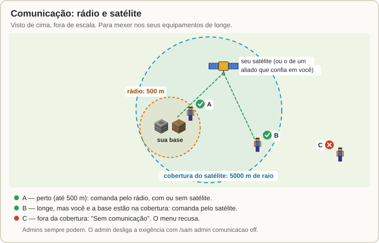
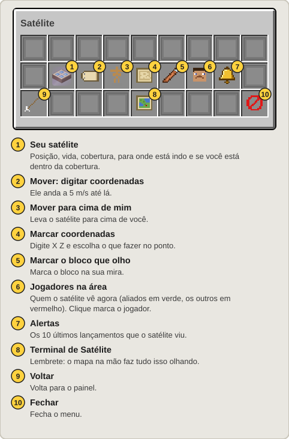
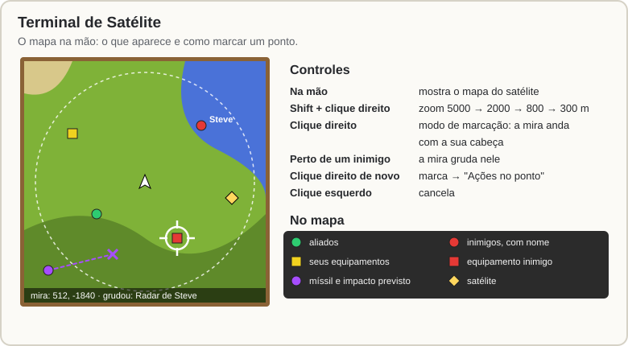
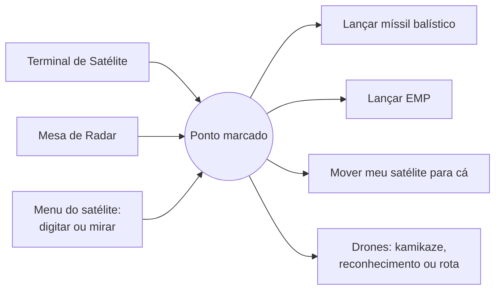

[Início](README.md) › Satélite

# Satélite

O **Satélite** fica em órbita em cima da sua base e faz três coisas:

1. **Comunicação:** é ele que deixa você comandar os seus equipamentos **de longe** (mais de 500 m).
2. **Mapa:** mostra no [Terminal de Satélite](#terminal-de-satélite) e na [Mesa de Radar](Mesa-de-Radar.md) todos os jogadores e equipamentos num raio de **5000 m**. No mapa você **marca um ponto** e manda um míssil ou drone até ele.
3. **Alerta antecipado:** avisa quando ele vê um lançamento de míssil.

Ele é **físico**: dá para subir até ele e destruí-lo, ou derrubá-lo com um míssil.

## Lançando

1. Faça um [Satélite](Receitas.md#satélite-1) e ponha no seu [Silo](Silo-e-Missil-Balistico.md).
2. No menu do silo, clique em **Lançar satélite** e confirme.
3. O foguete sobe e o satélite para a **Y 304** (16 blocos abaixo do teto do mundo): em cima do silo, ou nas coordenadas do alvo do silo se estiverem a até 2000 m.

**Um satélite por jogador.** Só funciona em mundos sem teto (o mundo normal).

## Comunicação: rádio e satélite

- **Até 500 m** de um equipamento você o comanda pelo "rádio", com ou sem satélite.
- **Mais longe**, você só gerencia e lança se **você e o equipamento** estiverem dentro da cobertura (5000 m) de um satélite: o seu, ou o de um aliado que confia em você.
- Sem isso o menu avisa **"Sem comunicação"** e recusa.
- Vale para tudo: menus, lançamentos, drones, defesa e alertas. Admins sempre podem.

## Movendo o satélite

`/sam satelite` (ou o botão **Satélite** no painel) → **Mover: digitar coordenadas** ou **Mover para cima de mim**. Ele anda a **5 m/s**. Você só consegue comandar o satélite de dentro da cobertura dele.

## Terminal de Satélite

O [Terminal de Satélite](Receitas.md#terminal-de-satélite) é um mapa que você segura na mão. Ele mostra o que o satélite vê.

**No mapa:** o relevo, a cobertura, você (seta branca), aliados (verde), inimigos (vermelho, com nome), equipamentos, mísseis com o ponto de impacto previsto e satélites. Os seus equipamentos e os dos aliados aparecem sempre; os inimigos, só dentro da cobertura.

| Botão | O que faz |
|---|---|
| **Shift + clique direito** | Zoom: 5000, 2000, 800 e 300 m de raio. |
| **Clique direito** | Entra no modo de marcação. A mira anda com a sua cabeça: gire para os lados e olhe para cima ou para baixo. As coordenadas aparecem embaixo. |
| (mira perto de um inimigo) | Ela **gruda** no jogador ou equipamento inimigo. |
| **Clique direito de novo** | Marca o ponto e abre as **Ações no ponto**. |
| **Clique esquerdo** | Cancela a marcação. |

O relevo do mapa vem dos chunks que já carregaram no servidor e de uma varredura lenta dos chunks já gerados em volta do satélite.

## Ações no ponto

Depois de marcar um ponto (no Terminal, num quadro da [Mesa de Radar](Mesa-de-Radar.md) ou digitando no menu do satélite), abre esta tela:

- **Lançar míssil balístico / Lançar EMP:** a lista mostra os seus silos e se cada um alcança o ponto. Escolha um e confirme.
- **Drones:** escolha uma Base de Drones sua e mande um kamikaze ou um reconhecimento, ou ponha o ponto na rota da patrulha. Veja [Drones](Drones.md).
- **Jogador marcado:** o míssil vai aonde o jogador estiver **na hora do lançamento**; o kamikaze o persegue.

## Alerta antecipado

Quando o seu satélite vê um **lançamento** de balístico, satélite ou antissatélite (a origem ou o ponto de impacto dentro da cobertura), chega no chat: de onde saiu, onde vai cair e em quanto tempo. Se o impacto for a até **300 m** de um equipamento seu (ou de você), aparece um aviso grande na tela. Os 10 últimos ficam em **Alertas** no menu do satélite. Lançamentos de quem você confia não geram alerta.

Uma [Sirene de Alerta](EMP-e-Alertas.md#sirene-de-alerta) também pode tocar com esses avisos.

## Derrubar um satélite

O satélite tem **100 de vida**. O dono é avisado de quem está atacando.

- **Subindo até ele** (construindo ou de elytra): o casco é sólido, dá para ficar em pé em cima, e leva dano de **tudo** do jogo: TNT, cristal do End, creeper, espada, flecha, tridente, foguete teleguiado. Uma TNT encostada tira cerca de 35.
- **Com o [Míssil Antissatélite](Receitas.md#míssil-antissatélite):** ponha no seu silo, clique em **Antissatélite** no menu do silo e escolha um satélite inimigo a até **3000 m**. O míssil mira onde o satélite vai estar quando chegar e tira 100 de vida se explodir a até 25 m dele.
- **Na subida:** o foguete do satélite e o antissatélite podem ser derrubados pela [besta](Besta.md) e por [SAMs](Radar-e-Misseis-SAM.md#drones-e-mísseis-inimigos-antidrone-e-antimíssil), como os outros mísseis.

Sem satélite, você volta a comandar só a até 500 m. Para ter outro, lance um novo pelo silo.

---

← [Comportas e Ferramenta de Link](Comportas-e-Ferramenta-de-Link.md) · Próximo: [Drones](Drones.md) →
