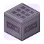
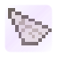
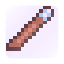
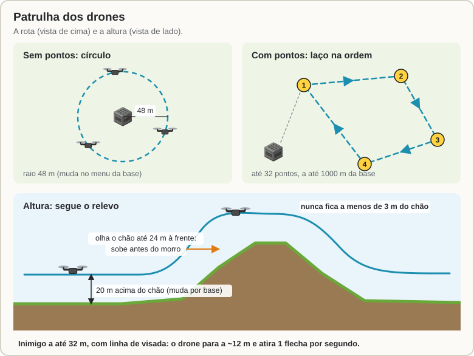
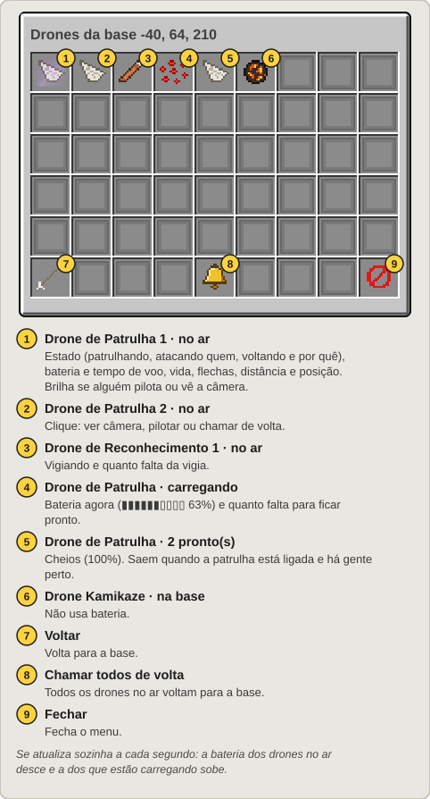
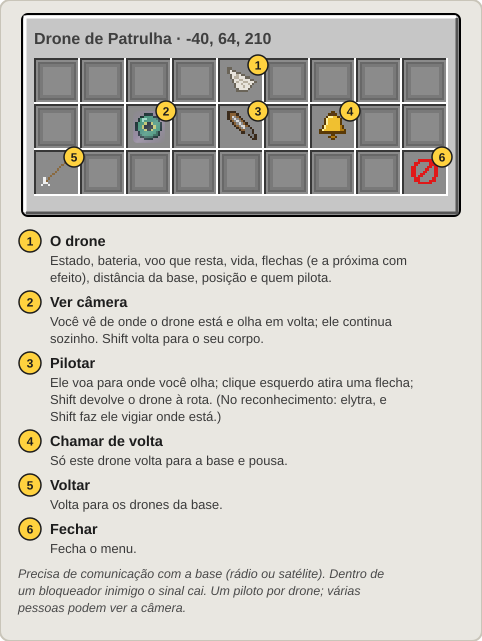
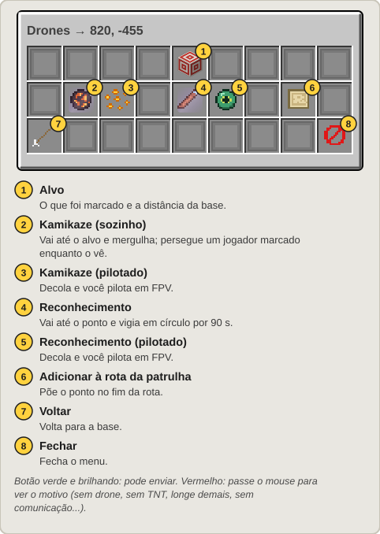

[Início](README.md) › Drones

# Drones

Uma **Base de Drones** guarda e lança três drones:

| | Drone | O que faz |
|:---:|---|---|
|  | **Patrulha** | Voa uma rota em volta da base acompanhando o relevo e atira flechas nos inimigos e nos mobs que você escolher. Dá para ver a câmera ou pilotar. |
|  | **Reconhecimento** | Vai até um ponto e vigia. O que ele vê entra na sua rede de radares. |
|  | **Kamikaze** | Leva TNT da base até um ponto, jogador ou equipamento e explode. Vai sozinho ou você pilota em FPV. |

## A Base de Drones

- É uma **bancada automática (crafter)** que não fabrica nada. Coloque e ponha dentro **drones**, **flechas** (munição da patrulha) e **TNT** (ogiva dos kamikazes). Só esses itens entram, e funis não tiram nada dela.
- Gerencie com **`/sam drones`** (olhando para a base, abre ela) ou `/sam` → **Bases de Drones**.
- Os drones saem voando **para cima**: deixe o céu livre ou ponha uma [Comporta](Comportas-e-Ferramenta-de-Link.md) em cima, que abre sozinha quando um drone sai ou pousa.

A tela da base se atualiza sozinha a cada segundo. Os ícones da patrulha e do reconhecimento dizem quantos drones estão **prontos**, **carregando** e **no ar**, com a bateria de cada um.

## O drone no mundo

- Um modelo de blocos com quatro hélices girando.
- Leva dano de **tudo** do jogo: flecha, espada, explosão, foguete, fogo. Vida: 20 (patrulha) e 12 (reconhecimento).
- Derrubado, ele se desfaz e **o item se perde**. O dono é avisado de quem derrubou.
- Ao pousar (ou quando o servidor desliga), ele volta como item para dentro da base. Se ela estiver cheia ou descarregada, entra quando der.
- Cada drone carrega os chunks em volta dele e à frente enquanto voa.

## Patrulha

- Com a **patrulha ligada** (padrão), todos os drones de patrulha da base saem, um a cada 3 s, e voam a rota. Não há limite de drones por base.
- **Só voam com gente por perto:** enquanto houver um jogador a até 256 m da base ou da rota. Sem ninguém, os drones são guardados.
- **Rota:**
  - **sem pontos:** um círculo de 48 m em volta da base (o raio muda no menu, em **Rota da patrulha**);
  - **com pontos:** um laço que passa por eles na ordem. Até 32 pontos, a até 1000 m da base.
- **Para marcar os pontos:**
  - com a [Ferramenta de Link](Comportas-e-Ferramenta-de-Link.md#ferramenta-de-link): clique na base e depois nos blocos, na ordem (Shift + clique tira o último);
  - no menu da base: **Rota da patrulha** → **Adicionar minha posição**;
  - pelo mapa do satélite: marque o ponto → **Drones** → a base → **Adicionar à rota da patrulha**.
- **Altura:** 20 m acima do terreno (muda por base no menu, de 5 em 5 m). O drone olha o chão embaixo e até 24 m à frente: sobe antes de chegar num morro e nunca fica a menos de 3 m do chão.
- **Ataque:** alvos a até **32 m**, com linha de visada. O drone para a uns 12 m do alvo e atira **1 flecha por segundo**, com a mira (e a imprecisão) de um esqueleto. Cada drone leva até 32 flechas da base. As flechas não podem ser pegas e não ferem você, seus aliados nem os drones de vocês.
- **Volta para a base** com pouca vida, pouca bateria (5 min de voo), sem flechas ou quando você clica em **Chamar todos de volta**. A tela mostra o motivo, como "Voltando: bateria baixa".

### Alvos da patrulha

Três chaves no menu da base escolhem em que a patrulha atira:

| Chave | Padrão | O que entra |
|---|:---:|---|
| **Atirar em jogadores inimigos** | ligada | Pelas regras do radar: nunca você, seus aliados e o seu time. |
| **Atirar em monstros** | ligada | Zumbis, esqueletos, creepers, aranhas, phantoms e os outros mobs hostis. |
| **Atirar em animais** | desligada | Vacas, porcos, ovelhas, cavalos, lobos... |

- Um **jogador inimigo vem sempre primeiro**: se ele aparece enquanto o drone ataca um mob, o drone troca de alvo.
- **Nunca são alvo:** aldeões, golens, peixes e morcegos; os animais domesticados por você ou pelos seus aliados; os mobs com **etiqueta de nome**; e os que o servidor pôs na lista de ignorados (por padrão, endermen, que teleportam e só gastam flechas, o ender dragon, o wither e o warden).
- O padrão das chaves vem do servidor. Quando você muda uma, o menu mostra "Escolhido nesta base".
- Num mob, a flecha é do drone, e o mob não vai atrás de você. Num jogador, o abate conta para você.

## Bateria e carga

- Cada drone tem bateria: **5 min de voo** na patrulha e **3 min** no reconhecimento. O kamikaze não tem.
- Na base, ele carrega **só o que falta**. De 0 a 100% leva **20 s**. Um drone que volta com 80% fica pronto em 4 s, e um que volta com 10%, em 18 s.
- Ele só sai de novo **cheio**. Enquanto o reconhecimento carrega, a missão espera e o menu diz quanto falta.
- Tirar o drone da base e colocar de volta não pula a carga. A carga também continua depois que o servidor reinicia.

## Drones da base

O botão **Drones da base**, no menu da base, abre a lista de todos os drones dela. A lista se atualiza sozinha a cada segundo:

- **Cada drone no ar:**
  - o que está fazendo: saindo, patrulhando (e o ponto da rota), atacando quem, indo, vigiando (e quanto falta), voltando (e por quê) ou pousando;
  - a bateria e o tempo de voo que resta;
  - a vida, as flechas, a distância da base e a posição;
  - quem está pilotando e quantos estão vendo a câmera.
- **Cada drone carregando:** a bateria agora e quanto falta para ficar pronto.
- **Os prontos** (100%) de cada tipo e os kamikazes da base.

## Câmera e pilotagem

Clique num drone no ar, na lista **Drones da base**:

- **Ver câmera:** você vê de onde o drone está e olha em volta. Ele continua sozinho: a patrulha segue a rota e atira, e o reconhecimento segue a missão. A barra de cima mostra a bateria, o tempo de voo, o que ele está fazendo e as flechas. **Shift** volta para o seu corpo.
- **Pilotar:** o drone voa para onde você olha.
  - Na **patrulha**, o **clique esquerdo atira uma flecha** para onde você mira, uma por segundo, das flechas que o drone leva. **Shift** devolve o drone à rota.
  - No **reconhecimento**, **Shift** faz ele vigiar onde está.
- **Chamar de volta:** só este drone volta para a base.

Como o FPV do kamikaze, o seu corpo fica parado onde você estava, e você volta para ele no fim. Ver a câmera e pilotar precisam de comunicação com a base, como os outros equipamentos. Dentro de um bloqueador inimigo o sinal cai. Só uma pessoa pilota cada drone, mas várias podem ver a câmera.

## Missões: kamikaze e reconhecimento

**Como mandar:**

- No menu da base: **Enviar para coordenadas** ou **Enviar para o bloco que olho** abre a tela de missão.
- Pelo mapa do satélite ([Terminal](Satelite.md#terminal-de-satélite) ou [Mesa](Mesa-de-Radar.md)): marque o ponto → **Drones** → escolha a base.
- Pilotado na hora: **Kamikaze pilotado agora** ou **Reconhecimento pilotado agora**, direto no menu da base.

### Kamikaze

- **Sozinho:** o alvo pode ser um ponto, um jogador ou um equipamento inimigo marcado no mapa do satélite, umas coordenadas ou o bloco que você olha. Ele decola reto, cruza 20 m acima do terreno a ~25 m/s e mergulha no alvo. Um jogador é perseguido enquanto o kamikaze o vê; se ele sumir, o kamikaze vai ao último lugar onde o viu. **Alcance: 1200 m.**
- **Pilotado:** decola da base e você pilota em FPV de onde estiver, como o foguete da besta (o seu corpo fica no lugar). **Shift** sai, e ele se desfaz no ar.
- **Ogiva:** a TNT da base, até **4 por kamikaze** (1 TNT = uma TNT normal). É uma explosão normal do jogo: quebra blocos com `mobGriefing` ligada.
- O alvo vê na tela **"⚠ DRONE"** com a distância.

### Reconhecimento

- Vai até o ponto (ou até o jogador marcado, e o acompanha) a **30 m do chão** e vigia em círculo por **90 s**.
- Os inimigos que ele vê a até **96 m** entram na **sua rede de radares**: aparecem na Mesa e no Terminal, e os SAMs atiram se estiverem ao alcance de um lançador.
- **Pilotado:** você leva o drone em FPV para onde olha. **Shift** sai, e ele fica vigiando onde está. Um reconhecimento que já está no ar também pode ser visto ou pilotado pela lista [Drones da base](#drones-da-base).

## De longe

Como os outros equipamentos, mandar um drone de longe precisa de **comunicação** (rádio a 500 m ou [satélite](Satelite.md)). Se a base estiver descarregada, ela é carregada para o lançamento.

## Contra drones

Radares derrubam drones inimigos ([antidrone](Radar-e-Misseis-SAM.md#drones-e-mísseis-inimigos-antidrone-e-antimíssil)). A [besta](Besta.md) trava neles, o [CIWS](Guerra-Eletronica-e-CIWS.md#ciws) atira neles, um [Bloqueador de Radar](Guerra-Eletronica-e-CIWS.md#bloqueador-de-radar) corta o sinal e um [EMP](EMP-e-Alertas.md#ogiva-emp) derruba todos os que estiverem na área. Qualquer arma do jogo também funciona.

---

← [Satélite](Satelite.md) · Próximo: [Guerra eletrônica e CIWS](Guerra-Eletronica-e-CIWS.md) →
