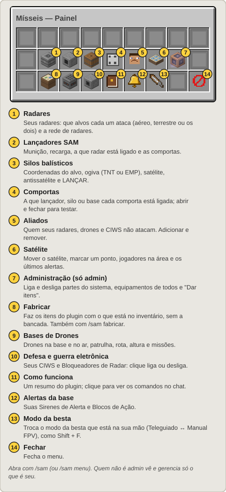
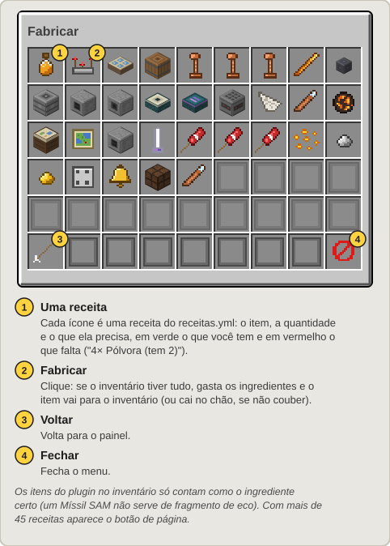
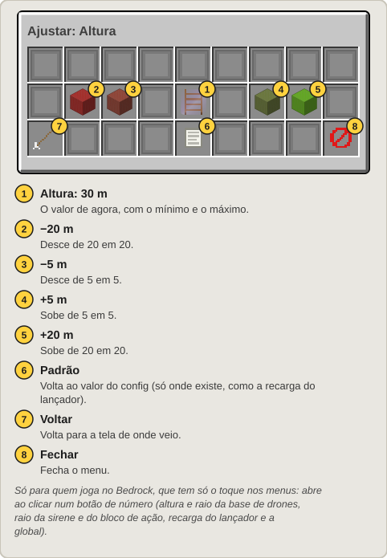
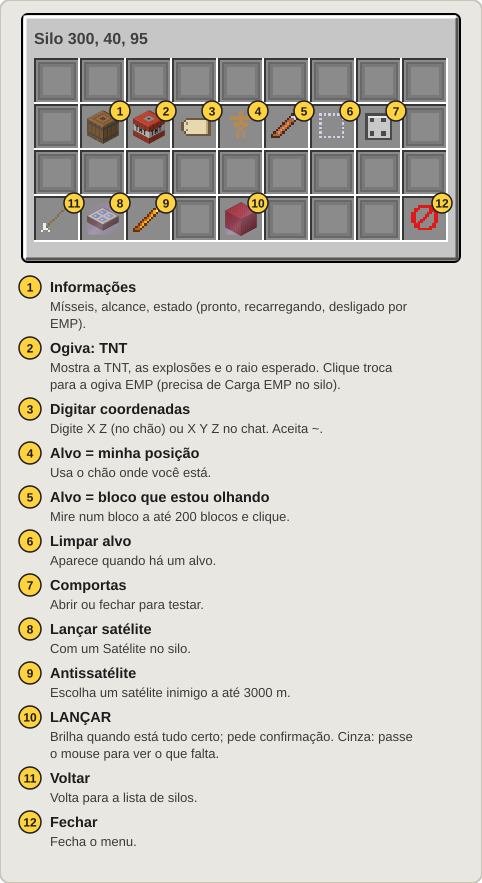
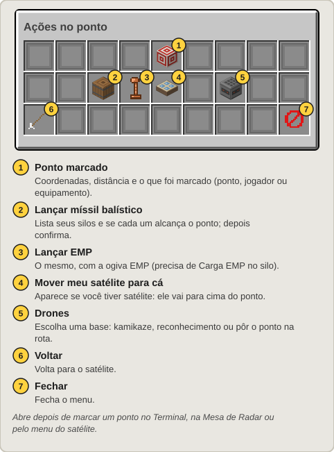
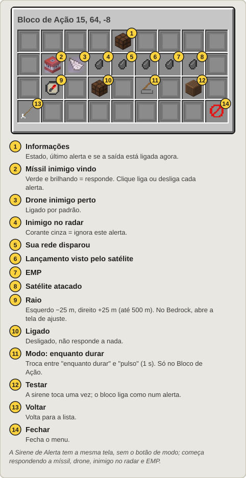

[Início](README.md) › O menu /sam

# O menu `/sam`

Digite **`/sam`** (ou `/sam menu`) para abrir o painel. É um baú com um botão para cada tipo de equipamento. Clique num botão para ver a lista dos seus equipamentos daquele tipo e clique em um para abrir a tela dele.

- Quem não é admin vê e gerencia **só o que é seu**.
- Nas listas, os equipamentos mais perto de você aparecem primeiro. Num chunk descarregado (ninguém por perto) aparecem menos detalhes. O silo e a base de drones mostram os números da última visita, e o silo carrega sozinho quando você abre a tela dele.
- De longe (mais de 500 m), abrir e mexer num equipamento precisa de [comunicação pelo satélite](Satelite.md#comunicação-rádio-e-satélite).
- Passe o mouse em cima de qualquer botão: o texto explica o que ele faz e, quando algo não dá, por quê.

Os números amarelos nos desenhos abaixo correspondem à legenda de cada tela.

## Painel

**3.1.0:** o painel tem 6 linhas, por grupos: **Ataque** (silos, lançadores, radares, comportas, modo da besta), **Defesa** (defesa, minas, alertas, câmeras), **Logística** (drones, robôs, depósitos, fabricar) e **Comunicação** (satélite, contrabateria, aliados); embaixo, **Como funciona** e **Fechar**. (A imagem acima ainda é a do painel antigo.)

Em toda tela, **Voltar** fica no canto de baixo à esquerda e **Fechar** no de baixo à direita. Onde se marca um ponto ou uma área, dá para clicar com a Ferramenta de Link ou usar **[Usar minha posição]** no chat.

**Minas:** a lista das suas minas, da mais perto para a mais longe. Clicar numa abre a tela dela. Veja [Ogivas e minas](Ogivas-e-Minas.md#minas).

## Fabricar

Todas as receitas do servidor, cada uma com o que pede e quanto você tem. Um clique faz o item com o que está no inventário, sem a bancada. Também abre com `/sam fabricar`.

## Modo da besta

Troca o modo da besta que está na sua mão principal (Teleguiado ↔ Manual FPV), o mesmo que **Shift + F** ou **agachado + clique esquerdo** com ela. Veja [Besta](Besta.md).

## Tela de ajuste (Bedrock)

No Bedrock só existe o toque (clique esquerdo) nos menus. Para quem joga lá, os botões de número que no Java usam esquerdo/direito abrem esta tela: a altura e o raio da base de drones, o raio da sirene e do bloco de ação, e a recarga do lançador e a global (admin). No Java nada muda. Veja [Jogar no Bedrock](Bedrock.md).

## Radares, rede e lançadores

| Radar | Rede do radar |
|:---:|:---:|
|  |  |

| Lançador | |
|:---:|:---:|
|  | Veja [Radar e mísseis SAM](Radar-e-Misseis-SAM.md). |

## Silo

Ao clicar em **LANÇAR**, uma tela de confirmação mostra o alvo, a distância e a ogiva. Veja [Silo e Míssil Balístico](Silo-e-Missil-Balistico.md).

## Satélite e Ações no ponto

| Satélite | Ações no ponto |
|:---:|:---:|
|  |  |

Veja [Satélite](Satelite.md).

## Base de Drones e missão

| Base de Drones | Missão (drones → ponto) |
|:---:|:---:|
|  |  |

| Drones da base | Um drone |
|:---:|:---:|
|  |  |

A base, os drones da base e a tela de um drone se atualizam sozinhas a cada segundo. Veja [Drones](Drones.md).

## Defesa

Uma lista com os seus CIWS e Bloqueadores de Radar. Cada ícone mostra o estado, a munição (CIWS), o alcance e os abates. **Clique para ligar ou desligar.** Veja [Guerra eletrônica e CIWS](Guerra-Eletronica-e-CIWS.md).

## Alertas

Veja [EMP e alertas da base](EMP-e-Alertas.md).

## Aliados e Comportas

- **Aliados:** quem você confia (os seus radares, drones e CIWS não atacam). Adicione e remova por ali ou com `/sam confiar` e `/sam desconfiar`.
- **Comportas:** a que lançador, silo ou base cada comporta está ligada. Abra e feche para testar.

## Administração (só admins)

Desde a 3.1.0 a administração não fica mais no painel: quem tem a permissão `missil.admin` abre com **`/sam admin`**. Veja [Administração](Administracao.md).

---

← [Receitas](Receitas.md) · Próximo: [Besta](Besta.md) →
