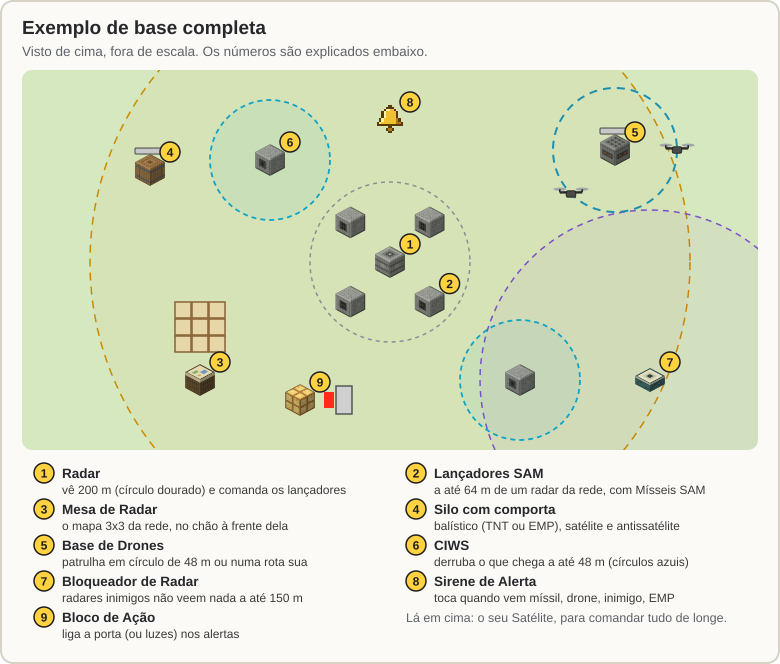
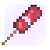
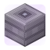
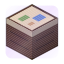
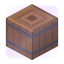
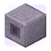

# Wiki do Míssil Teleguiado

Esta wiki explica o plugin de mísseis, radares, satélite, drones e defesa do servidor para quem acabou de chegar. Para cada coisa ela diz o que faz, como fabricar e como usar. Vale para a versão **3.0.0** (Minecraft Paper 26.3). Joga no celular, console ou Windows? Veja [Jogar no Bedrock](Bedrock.md).

## Comece por aqui

1. **[Primeiros passos](Primeiros-Passos.md)**: monte em poucos minutos uma defesa que atira sozinha e depois vá crescendo.
2. **[Receitas](Receitas.md)**: a bancada de trabalho de cada item, com os ícones do jogo e as receitas padrão (o servidor pode mudar). As receitas também aparecem no seu livro de receitas assim que você entra no servidor.
3. **[O menu `/sam`](Menu.md)**: o painel onde você vê e controla todos os seus equipamentos.

## Tudo o que dá para fazer

| | Assunto | Resumo |
|:---:|---|---|
|  | [Besta e Foguete Teleguiado](Besta.md) | Trave num alvo e dispare, ou pilote o foguete em primeira pessoa (FPV). Também derruba mísseis e drones. |
|  | [Radar e mísseis SAM](Radar-e-Misseis-SAM.md) | O radar vê quem voa (ou anda) por perto e os lançadores atiram sozinhos. Vários radares viram uma rede. |
|  | [Mesa de Radar](Mesa-de-Radar.md) | Um mapa 3x3 no chão com tudo o que a sua rede vê. Também serve para marcar alvos. |
|  | [Silo e Míssil Balístico](Silo-e-Missil-Balistico.md) | Um míssil que vai até as coordenadas que você escolher, com ogiva de TNT ou EMP, e o Míssil de Cruzeiro, que voa baixo pelo relevo. |
|  | [Comportas e Ferramenta de Link](Comportas-e-Ferramenta-de-Link.md) | Esconda lançadores, silos e bases debaixo da terra. Ligue radares, lançadores e comportas. |
|  | [Satélite](Satelite.md) | Comanda a base de longe, mostra um mapa de 5000 m e avisa de lançamentos. Pode ser derrubado. |
|  | [Drones](Drones.md) | Patrulha armada com rota (contra inimigos e mobs), reconhecimento que alimenta o radar e kamikaze (sozinho ou pilotado). Bateria, carga, câmera e pilotagem de cada drone. |
|  | [Guerra eletrônica e CIWS](Guerra-Eletronica-e-CIWS.md) | Flare, chaff, dispensador, bloqueadores de radar e a torreta CIWS que derruba o que chega perto. |
|  | [EMP e alertas da base](EMP-e-Alertas.md) | A ogiva que desliga equipamentos sem quebrar nada, a sirene e o Bloco de Ação para circuitos de redstone. |
|  | [Ogivas e minas](Ogivas-e-Minas.md) | As ogivas do silo (perfurante, incendiária, fumaça e múltipla), a granada de fumaça e as minas terrestre, antidrone e naval. |
|  | [Vida, contrabateria e depósito](Base.md) | Os equipamentos têm vida e o Kit de Reparo conserta; de onde veio o míssil inimigo e a retaliação; o depósito que abastece a base sozinho. |
|  | [Câmeras](Cameras.md) | Câmeras de segurança que avisam quando veem alguém, a tela ao vivo numa moldura, o Tablet e as fotos. |
|  | [Robôs](Robos.md) | Robôs de defesa, minerador, explorador e trabalhador: guardados na Estação de Robôs, trabalham sozinhos, sem raio-X, e voltam para carregar. |
|  | [Jogar no Bedrock (Geyser)](Bedrock.md) | Celular, console e Windows pelo Geyser: o que muda nos controles, a tela de ajuste, a tela Fabricar e como o admin instala. |

## Consulta rápida

- [Comandos e permissões](Comandos-e-Permissoes.md): todos os `/sam ...`.
- [Perguntas frequentes](Perguntas-Frequentes.md): "meu radar não atira", "sem comunicação", "o silo não lança" e outras.
- [Administração](Administracao.md): para os admins do servidor (chaves de liga/desliga e o `config.yml`).
- [Jogar no Bedrock](Bedrock.md): Geyser, Floodgate e Velocity, passo a passo.

## Três regras que valem para tudo

- **Tudo é do dono.** Quem coloca um equipamento é o dono dele. Só o dono (ou um admin) mexe nele pelo menu.
- **Aliados não são atacados.** Use `/sam confiar <jogador>`. Seus radares, drones e CIWS não atacam aliados, nem quem é do mesmo time do scoreboard.
- **De longe, só com comunicação.** Até 500 m você comanda tudo pelo "rádio". Mais longe que isso, precisa de um [satélite](Satelite.md) cobrindo você e o equipamento.

---

Os desenhos desta wiki foram feitos para ela e lembram o jogo, mas não são as texturas do Minecraft. Números como alcance e tempo são os padrões do plugin: o admin do seu servidor pode ter mudado alguns.
