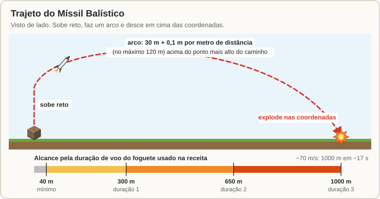
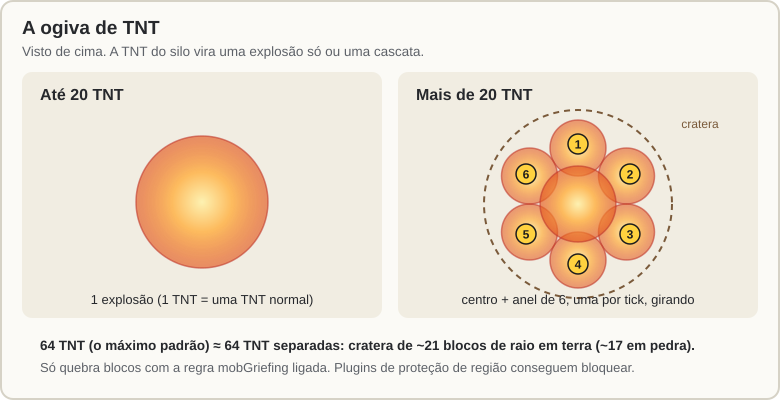

[Início](README.md) › Silo e Míssil Balístico

# Silo e Míssil Balístico

O **Silo de Míssil** lança um **Míssil Balístico** até as coordenadas que você escolher, onde ele explode. A **ogiva** é o que você guarda no silo: **TNT** (quanto mais, maior a explosão) ou uma **[Carga EMP](EMP-e-Alertas.md#ogiva-emp)**, que desliga equipamentos sem quebrar nada. O silo também lança o [Satélite](Satelite.md) e o [Míssil Antissatélite](Satelite.md#derrubar-um-satélite).

## Passo a passo

1. **Coloque o silo** (um barril; ele fica sempre virado para cima). Pode ficar na superfície ou enterrado, com uma [Comporta](Comportas-e-Ferramenta-de-Link.md) em cima.
2. **Abasteça:** clique direito no silo e ponha **Mísseis Balísticos** e **TNT**. Funis (hoppers) também abastecem. O silo só aceita mísseis (Balístico, Antissatélite), o Satélite, TNT, as cargas das ogivas e Chaff. Com um míssil dentro, ele aparece **em pé em cima do barril**, pronto para sair.
3. **Veja o tamanho da explosão:** a cada TNT colocada ou tirada, a barra de ação mostra o raio esperado. Ao fechar o silo, o resumo vai para o chat.
4. **Escolha o alvo** no menu (`/sam` → Silos → o silo): digite as coordenadas no chat, use **a sua posição** ou **o bloco que você está olhando**. Também dá para usar `/sam alvo <x> [y] <z>` olhando para o silo (aceita `~`). Sem Y, o míssil desce no chão daquele ponto.
5. **Lance:** botão **LANÇAR** no menu (pede confirmação) ou `/sam lancar` olhando para o silo. Também dá para lançar das [Ações no ponto](Satelite.md#ações-no-ponto), marcando no mapa.

Se o botão LANÇAR estiver cinza, passe o mouse em cima: ele diz o que falta (sem alvo, sem míssil, sem TNT, alvo perto ou longe demais, recarregando...).

## O voo

- O míssil sobe reto, faz um arco e desce em cima das coordenadas.
- Ele gasta **um míssil** (o de maior alcance) e **a TNT da ogiva**: até 64 TNT por lançamento; o resto fica no silo.
- Se bater em algo no caminho, explode ali mesmo.
- Ele pode ser **derrubado** pelo [foguete da besta](Besta.md), por [SAMs inimigos](Radar-e-Misseis-SAM.md#drones-e-mísseis-inimigos-antidrone-e-antimíssil) e por um [CIWS](Guerra-Eletronica-e-CIWS.md#ciws).
- Um [satélite](Satelite.md#alerta-antecipado) de outro jogador que cubra o silo ou o alvo vê o lançamento e avisa o dono dele.

| Nível do míssil | Alcance padrão |
|:---:|---|
| 1 | 40 a 300 m |
| 2 | 40 a 650 m |
| 3 | 40 a 1000 m (~17 s de voo) |

Cada nível tem a sua [receita](Receitas.md#míssil-balístico): o nível 1 é barato, o 2 pede diamantes e o 3 pede estrela do Nether e netherite. O nível aparece no item como "duração de voo". O alcance de cada nível é do servidor: num mapa grande, o admin pode deixar, por exemplo, 10, 20 e 30 mil blocos.

## O tamanho da explosão (ogiva de TNT)

| TNT na ogiva | Explosões | Raio da cratera em terra | Em pedra | Dano até |
|:---:|:---:|:---:|:---:|:---:|
| 1 | 1 (uma TNT normal) | ~4 blocos | ~3 | 8 blocos |
| 8 | 1 | ~9,5 | ~5 | 18 |
| 20 | 1 | ~13,5 | ~7,5 | 32 |
| 32 | 7 | ~16 | ~12,5 | 32 |
| 64 (máximo) | 7 (centro + anel de 6) | **~21** | ~17 | 40 |

- Até 20 TNT é uma explosão só. Com mais, é uma explosão no centro e, logo depois, um anel de explosões em volta, como TNT em cadeia. **64 TNT tiram quase os mesmos blocos que 64 TNT separadas.**
- **A explosão é do dono do silo.** Ela só quebra blocos se a regra `mobGriefing` do mundo estiver ligada (o padrão do Minecraft), esteja o dono online ou não. Desligada, a ogiva só causa dano, e o menu avisa. Plugins de proteção de região conseguem bloquear as explosões.

## Ogiva EMP

Com **Cargas EMP** no silo, clique em **Ogiva** no menu do silo até chegar na EMP (o botão passa por todas as ogivas; o clique direito volta). As outras ogivas (perfurante, incendiária, fumaça e múltipla) estão em [Ogivas e minas](Ogivas-e-Minas.md). O lançamento gasta um míssil e uma carga; a TNT fica guardada. O míssil voa igual, mas na chegada não quebra nada: desliga por 60 s os equipamentos a até 64 m. Veja [Ogiva EMP](EMP-e-Alertas.md#ogiva-emp).

## Lançar de longe

- **Dá para lançar de longe.** Abrir o silo no menu carrega o chunk dele e o das comportas e mostra o que tem dentro. Se ninguém estiver perto, o lançamento carrega o silo sozinho antes de soltar o míssil.
- Antes de soltar o míssil, o plugin carrega **o caminho inteiro e a área do alvo**. Por isso o míssil não "some" no meio do caminho nem chega num lugar descarregado, mesmo com todos os jogadores longe.
- Mais longe que 500 m você precisa de **comunicação**: um [satélite](Satelite.md) cobrindo você e o silo.

## Regras

- O silo precisa ser seu (admins lançam de qualquer um) e você precisa da permissão `missil.balistico` (todo mundo tem, a não ser que o admin tire).
- Entre dois lançamentos do mesmo silo há uma **recarga de 10 s**.
- O admin pode desligar os balísticos no servidor inteiro.

---

← [Mesa de Radar](Mesa-de-Radar.md) · Próximo: [Comportas e Ferramenta de Link](Comportas-e-Ferramenta-de-Link.md) →
